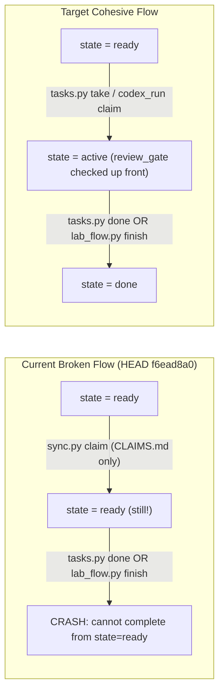

# Backlog Refinement: Gap Audit & Implementation Report

**Date:** 2026-10-18  
**Commit Audited:** `f6ead8a0` (`origin/fast-track`)  
**Scope:** [`scripts/dev/tasks.py`](file:///f:/MTS/mts-gemini/scripts/dev/tasks.py), [`scripts/dev/task_state.py`](file:///f:/MTS/mts-gemini/scripts/dev/task_state.py), [`scripts/dev/lab_flow.py`](file:///f:/MTS/mts-gemini/scripts/dev/lab_flow.py), [`scripts/dev/codex_run.py`](file:///f:/MTS/mts-gemini/scripts/dev/codex_run.py), [`scripts/dev/ci_red_card.py`](file:///f:/MTS/mts-gemini/scripts/dev/ci_red_card.py), [`scripts/sched/relay.py`](file:///f:/MTS/mts-gemini/scripts/sched/relay.py), [`MyTradingSys/system/TASK_REFINEMENT.md`](file:///f:/MTS/mts-gemini/MyTradingSys/system/TASK_REFINEMENT.md), [`MyTradingSys/system/roles/session_planner.md`](file:///f:/MTS/mts-gemini/MyTradingSys/system/roles/session_planner.md), [`MyTradingSys/system/roles/lab_guy.md`](file:///f:/MTS/mts-gemini/MyTradingSys/system/roles/lab_guy.md), and all **318 task cards** under `MyTradingSys/system/tasks/*.json`.

---

## Executive Summary & Baseline Inventory

Running the existing backlog CLI at `HEAD` (`f6ead8a0`) produces a seemingly healthy status line, while `stale` fails with exit code `1`:

```text
$ python scripts/dev/tasks.py status
REFINE_OK refinable=24 parked=1 ready=63 builder_ready=30 buffer=3
raw 12 | refined 13 | ready 63 | active 0 | blocked 8 | done 203 | dropped 19

$ python scripts/dev/tasks.py lint
OK: 318 cards, 63 ready, 25 raw/refined
```

However, cross-validating `tasks.py` gates against the 318 cards, `ANNOUNCEMENTS.md`, `CLAIMS.md`, and runner scripts (`codex_run.py`, `lab_flow.py`, `relay.py`) reveals **8 structural gaps**—including **1 critical lifecycle break** and **3 high-severity gate/regex bugs** that are actively rejecting or misrouting work right now.

| ID | Severity | Gap Summary | Live Impact (Proven on 318 Cards) |
| :--- | :--- | :--- | :--- |
| **G1** | **CRITICAL** | `cmd_done` & `lab_flow.finish` require `state == "active"`, but **no workflow or runner calls `tasks.py take`** | **100% of in-flight builders (7 claimed cards) and `codex_run.py` runs will crash at close** (`0` cards are `active`; 93.1% of historical `done` cards skipped `take`). |
| **G2** | **HIGH** | `ready_cards()`, `cmd_check()`, and `cmd_lint()` ignore `promotion_problems()` and `review_gate()` for already-`ready` cards | **26 of 63 `ready` cards (41%)** fail promotion checks; **18 of 63 (29%)** fail `review_gate()` and cannot be taken or closed, yet `tasks.py next` serves them. |
| **G3** | **HIGH** | `active_holds()` parses the `## EXPIRED` section of `ANNOUNCEMENTS.md`, while `HOLD_RE` ignores `STOP A-...` in card notes | **15 cards** are falsely blocked by expired hold `A-20261018-5`, while `gap-g2-dax-ask-candles` bypasses active stop `A-20261018-6`. |
| **G4** | **HIGH** | `stamp_kind()` returns on the **first** regex match (`T0-ONLY` beats later `ACCEPT`), requires start-of-line `^`, and rejects trailing periods (`ACCEPT.`) | **13 reviewed cards** have broken stamp parsing (`2` early-return, `5` mid-line after unblock notes, `6` trailing period). |
| **G5** | **MEDIUM** | `promote_shared()` matches a card against **itself**, overwrites higher weights (`CRUCIAL`/`CRITICAL`), and `B-SHARED` has no review gate in `needs_review()` | **10 of 12 `B-SHARED` cards (83%)** were self-promoted with 0 external citations; all 12 bypass `needs_review()`. |
| **G6** | **MEDIUM** | Definition-of-Ready (`problems()`) loopholes: optional `mutation_check` key, unverified `scope_in` paths, `refs` vs `sources` pollution, and empty `weight` | **11 of 13 `ready` CODEX build cards** omit `mutation_check`; **11 `ready` cards** have `0` existing `scope_in` paths; **28 open cards** have broken `refs`. |
| **G7** | **MEDIUM** | `task_state.py` flags cards stale when `scope_sha` differs even if `refreshed > commit_ts`, and computes `overdue()` from commit age instead of `refreshed` | `tasks.py stale` exits `1` on **12 `ready` cards**, printing paradoxical messages (`scope changed 2026-10-17 after refresh 2026-10-18`). |
| **G8** | **LOW/MED** | Queue & Control Room visibility drift (`builder_ready` inflated by 50%, `summary()` hides review/promotion blocks, `ci_red_card.py` schema mismatch, doc drift) | `status` reports `builder_ready=30` when only **20** are actually unclaimed & takeable; Control Room shows 18 un-takeable cards as green `"Ready"`. |

---

## Detailed Findings, Proofs & Implementation Fixes

---

### Gap 1 (CRITICAL): Broken `ready` $\rightarrow$ `active` $\rightarrow$ `done` Lifecycle Contract

#### 1. Root Cause
Commit `49ea3754` (`lab-review-gate-harden`, weight `BLOCKED`) hardened [`cmd_done`](file:///f:/MTS/mts-gemini/scripts/dev/tasks.py#L677-L680) and [`lab_flow.finish`](file:///f:/MTS/mts-gemini/scripts/dev/lab_flow.py#L325-L326) to reject closing any card whose `state != "active"`:

- [`scripts/dev/tasks.py#L677-L680`](file:///f:/MTS/mts-gemini/scripts/dev/tasks.py#L677-L680):
  ```python
  if c.get("state") != "active":
      raise SystemExit(
          f"cannot complete {args.id} from state={c.get('state')} (take it first)"
      )
  ```
- [`scripts/dev/lab_flow.py#L325-L326`](file:///f:/MTS/mts-gemini/scripts/dev/lab_flow.py#L325-L326):
  ```python
  if verdict == "PASS" and card.get("state") != "active":
      raise ValueError(f"card {card_id} must be active before PASS")
  ```

However, **none of the builder/runner tools or prompts call `tasks.py take <id>`**:
1. [`tasks.brief()`](file:///f:/MTS/mts-gemini/scripts/dev/tasks.py#L329) instructs sessions:
   ```python
   lines.append(f"Close: python scripts/dev/sync.py claim, work, python scripts/dev/tasks.py done {card['id']} --result \"...\"")
   ```
2. [`codex_run.run_card()`](file:///f:/MTS/mts-gemini/scripts/dev/codex_run.py#L703) claims the card via `sync.py claim`, never calls `tasks.py take`, and [`codex_run.prompt()`](file:///f:/MTS/mts-gemini/scripts/dev/codex_run.py#L509-L510) instructs the unattended Codex worker to close directly with `tasks.py done` or `lab_flow.py finish`.
3. [`relay.cmd_begin()`](file:///f:/MTS/mts-gemini/scripts/sched/relay.py#L646-L654) prints `tasks.py next` and `sync.py claim` without `tasks.py take`.
4. [`MyTradingSys/system/TASK_REFINEMENT.md#L54`](file:///f:/MTS/mts-gemini/MyTradingSys/system/TASK_REFINEMENT.md#L54) and [`MyTradingSys/system/GEMINI_START.md#L56`](file:///f:/MTS/mts-gemini/MyTradingSys/system/GEMINI_START.md#L56) omit `tasks.py take`.



#### 2. Actual Proof from Repository State
```text
=== DONE CARDS HISTORICAL AUDIT ===
Total done cards: 203
Done cards WITH 'taken' timestamp:    14 ( 6.9%)
Done cards WITHOUT 'taken' timestamp: 189 (93.1%)

=== LIVE IN-FLIGHT CLAIMS vs CARD STATE ===
Active cards in MyTradingSys/system/tasks/*.json: 0
Open claims in CLAIMS.md matching task cards:     7 (all state='ready'!)
  - eu-low-us-sweep-follow-ups-long-after-sw (state=ready, claimed by codex-eu-low-us-sweep-follow-ups-long-after-sw)
  - kurisko-quad-rotation-module             (state=ready, claimed by codex-kurisko-quad-rotation-module)
  - malkan-captions-fetch-noauth             (state=ready, claimed by codex-malkan-captions-fetch-noauth)
  - malkan-home-fit-audit                    (state=ready, claimed by codex-malkan-home-fit-audit)
  - positioning-home-fit-audit               (state=ready, claimed by codex-positioning-home-fit-audit)
  - rv02-fix-dax-full-dev-authorization      (state=ready, claimed by codex-rv02-fix-dax-full-dev-authorization)
  - tom-encode-fade-entry-paths              (state=ready, claimed by codex-tom-encode-fade-entry-paths)
```
Every one of those 7 running Codex jobs will fail at the end of its run when invoking `tasks.py done` or `lab_flow.py finish`.

#### 3. Implementation Fix
1. **Update [`tasks.brief()`](file:///f:/MTS/mts-gemini/scripts/dev/tasks.py#L329)**:
   Include `python scripts/dev/tasks.py take <id> --by <session>` in the `Close:` instruction line.
2. **Update [`codex_run.py`](file:///f:/MTS/mts-gemini/scripts/dev/codex_run.py#L509-L510)**:
   - In [`prompt()`](file:///f:/MTS/mts-gemini/scripts/dev/codex_run.py#L509-L510) (or inside [`run_card()`](file:///f:/MTS/mts-gemini/scripts/dev/codex_run.py#L703) right after `claim()`), transition the card to `active` via `tasks.py take <id> --by <session>` (or instruct the worker to run `tasks.py take` before `tasks.py done` / `lab_flow.py finish`).
3. **Graceful transition in [`cmd_done()`](file:///f:/MTS/mts-gemini/scripts/dev/tasks.py#L677-L686) and [`lab_flow.finish()`](file:///f:/MTS/mts-gemini/scripts/dev/lab_flow.py#L325-L326)**:
   - Either allow `state in ("ready", "active")` in `cmd_done()` and `lab_flow.finish()` **provided** `problems(c, cards, reg)`, `promotion_problems(c)`, and `review_gate(c)` all pass (auto-stamping `taken` if missing so `ready -> done` remains atomic without mutating card JSON on `fast-track` mid-claim), **or** wire `tasks.py take` into every runner and doc (`TASK_REFINEMENT.md`, `GEMINI_START.md`, `relay.py`).
   - *Note:* Auto-verifying all `take` gates inside `cmd_done`/`lab_flow.finish` for `state in ("ready", "active")` avoids merge conflicts on `MyTradingSys/system/tasks/<id>.json` between claim time and push time, while still enforcing 100% of the review/hold/DoR gates!

---

### Gap 2 (HIGH): `ready_cards()`, `cmd_check()`, and `cmd_lint()` Bypass `promotion_problems()` and `review_gate()`

#### 1. Root Cause
- [`ready_cards()`](file:///f:/MTS/mts-gemini/scripts/dev/tasks.py#L353-L358) only checks `not problems(c, cards, reg)`:
  ```python
  def ready_cards(cards: dict[str, dict], lane: str | None = None, reg: set[str] | None = None) -> list[dict]:
      reg = registry_ids(REPO) if reg is None else reg
      out = [c for c in cards.values() if c.get("state") == "ready" and not problems(c, cards, reg)]
  ```
- [`cmd_check()`](file:///f:/MTS/mts-gemini/scripts/dev/tasks.py#L444-L448) only runs `promotion_problems(c)` and `review_gate(c)` when `c.get("state") not in ("ready", "active")`:
  ```python
  if c.get("state") not in ("ready", "active"):
      probs.extend(promotion_problems(c))
      gate = review_gate(c)
      if gate:
          probs.append(gate)
  ```
- [`cmd_lint()`](file:///f:/MTS/mts-gemini/scripts/dev/tasks.py#L473-L479) only checks `problems(c, cards, reg)`.

Because of this, cards that were moved to `ready` before gate hardening (or edited manually) pass `tasks.py check <id>` and `tasks.py lint`, and are served at the top of `tasks.py next` and `codex_run.py next`, **even though `tasks.py take` and `tasks.py done` immediately reject them!**

#### 2. Actual Proof from Repository State
Running `promotion_problems(c)` and `review_gate(c)` across all 63 `ready` cards reveals:
- **26 of 63 `ready` cards (41.3%)** fail `promotion_problems(c)`.
- **18 of 63 `ready` cards (28.6%)** fail `review_gate(c)` and **cannot be taken or completed**, yet `tasks.py next` serves them to builders right now:

```text
=== 18 READY CARDS SERVED BY `tasks.py next` THAT FAIL `review_gate()` ===
1. context-composite-v2-dev-read     (lane=CODEX,  prio=1, weight=IMPORTANT) -> weight=IMPORTANT requires planner review stamp
2. dsa-audit-05-session-window-filter(lane=CLAUDE, prio=3, weight=IMPORTANT) -> held by active ANNOUNCEMENTS hold: A-20261018-5
3. dsa-audit-06-regime-tag           (lane=CLAUDE, prio=3, weight=IMPORTANT) -> held by active ANNOUNCEMENTS hold: A-20261018-5
4. dsa-audit-07-vix-tier-overlay     (lane=CLAUDE, prio=3, weight=IMPORTANT) -> held by active ANNOUNCEMENTS hold: A-20261018-5
5. dsa-audit-08-fee-sensitivity      (lane=CLAUDE, prio=3, weight=IMPORTANT) -> held by active ANNOUNCEMENTS hold: A-20261018-5
6. dsa-audit-10-combined-filtered-eq (lane=CLAUDE, prio=2, weight=CRUCIAL)   -> held by active ANNOUNCEMENTS hold: A-20261018-5
7. host-legacy-tasks-unregister      (lane=NUC,    prio=2, weight=IMPORTANT) -> weight=IMPORTANT requires planner review stamp
8. java-popups                       (lane=NUC,    prio=1, weight=IMPORTANT) -> weight=IMPORTANT requires planner review stamp
9. lab-formula-spec-recount          (lane=ANY,    prio=2, weight=IMPORTANT) -> weight=IMPORTANT requires planner review stamp
10. lab-formula-spec-text            (lane=ANY,    prio=1, weight=CRUCIAL)   -> weight=CRUCIAL requires real planner review stamp
11. lab-trust-tag                    (lane=ANY,    prio=1, weight=CRUCIAL)   -> weight=CRUCIAL requires real planner review stamp
12. move-live-host-generated-files   (lane=NUC,    prio=2, weight=IMPORTANT) -> weight=IMPORTANT requires planner review stamp
13. outcome-labeler-timeout          (lane=CLAUDE, prio=2, weight=IMPORTANT) -> weight=IMPORTANT requires planner review stamp
14. rv02-fix-dax-full-dev-auth       (lane=CODEX,  prio=1, weight=CRUCIAL)   -> weight=CRUCIAL requires real planner review stamp
15. snapshot-vwap-anchor-label       (lane=CLAUDE, prio=2, weight=IMPORTANT) -> weight=IMPORTANT requires planner review stamp
16. state-code-accumulator-backfill  (lane=CLAUDE, prio=2, weight=IMPORTANT) -> weight=IMPORTANT requires planner review stamp
17. tom-dax-backtest                 (lane=CLAUDE, prio=1, weight=CRUCIAL)   -> weight=CRUCIAL requires real planner review stamp
18. tom-encode-fade-entry-paths      (lane=CODEX,  prio=2, weight=CRUCIAL)   -> weight=CRUCIAL requires real planner review stamp
```
Notice that #14 (`rv02-fix-dax-full-dev-authorization`) and #18 (`tom-encode-fade-entry-paths`) were already picked up by `codex_run.py` and will fail `review_gate` at close!

#### 3. Implementation Fix
- In [`ready_cards()`](file:///f:/MTS/mts-gemini/scripts/dev/tasks.py#L353-L358): filter out cards where `review_gate(c, repo_holds)` is non-empty (and optionally `promotion_problems(c)`).
- In [`cmd_check()`](file:///f:/MTS/mts-gemini/scripts/dev/tasks.py#L444-L448): enforce `promotion_problems(c)` and `review_gate(c)` for `ready` and `active` cards as well, not just `raw`/`refined` cards.
- In [`cmd_lint()`](file:///f:/MTS/mts-gemini/scripts/dev/tasks.py#L473-L479): check `review_gate(c)` on `ready` cards so CI/planner catches un-takeable `ready` cards immediately.

---

### Gap 3 (HIGH): `active_holds()` Parses `## EXPIRED` Section and `HOLD_RE` Misses `STOP A-...`

#### 1. Root Cause
1. **False-positive active holds from `## EXPIRED`**:
   [`active_holds()`](file:///f:/MTS/mts-gemini/scripts/dev/tasks.py#L600-L606) scans the entire [`MyTradingSys/system/ANNOUNCEMENTS.md`](file:///f:/MTS/mts-gemini/MyTradingSys/system/ANNOUNCEMENTS.md#L18-L55) with:
   ```python
   ACTIVE_HOLD_HEAD_RE = re.compile(
       r"^### (A-\d{8}-\d+) (?:HOLD|STOP)(?!.*(?:LIFTED|RETIRED|CLOSED))", re.M
   )
   ```
   In [`ANNOUNCEMENTS.md`](file:///f:/MTS/mts-gemini/MyTradingSys/system/ANNOUNCEMENTS.md#L44-L50):
   ```markdown
   ## EXPIRED (last 5, older git-logged)
   ### A-20261018-5 HOLD — raw-bar consumer promotion gate (G2 + G8)
   - Posted: 2026-10-18T11:30Z by claude-opus (planner)
   ...
   - LIFTED 2026-10-18T12:15Z: G2 closed via Dukascopy ask download (3559 days, 2.02M bars) + rebuild_dax_15m --verify PASS. G8 dropped per user (no options trading). Unblocked: tom-btc-validation, lc-validation, tom-short-coverage-above-vah, lc-ladder-dev.
   ```
   Because `### A-20261018-5 HOLD` is under `## EXPIRED` and `- LIFTED` is on a bullet line below the `###` header (not on the header line itself), `ACTIVE_HOLD_HEAD_RE` matches `A-20261018-5` as an **active** hold!
2. **False-negative hold matching on `STOP A-...`**:
   [`HOLD_RE`](file:///f:/MTS/mts-gemini/scripts/dev/tasks.py#L559) is `re.compile(r"HOLD[ :]+(A-\d{8}-\d+)", re.I)`. When a card note cites `STOP A-20261018-6` instead of `HOLD A-20261018-6`, `hold_ids()` returns `set()`.

#### 2. Actual Proof from Repository State
```text
$ python -c "import sys; sys.path.insert(0,'scripts/dev'); import tasks as T; print(T.active_holds(T.REPO))"
{'A-20261018-5', 'A-20261018-6'}
```
- **15 cards falsely blocked by expired `A-20261018-5`**:
  - `refined` (8): `dsa-audit-01-oby-filter`, `dsa-audit-02-tier12-cap`, `dsa-audit-03-4h-trail-after-tp1`, `dsa-audit-04-3bar-time-stop`, `dsa-audit-09-mae-tight-stop`, `lc-ladder-dev`, `lc-validation`, `tom-btc-validation`
  - `ready` (5): `dsa-audit-05-session-window-filter`, `dsa-audit-06-regime-tag`, `dsa-audit-07-vix-tier-overlay`, `dsa-audit-08-fee-sensitivity`, `dsa-audit-10-combined-filtered-equity`
  - `blocked` (1): `tom-short-coverage-above-vah`
  - `dropped` (1): `gap-g8-deribit-parity`
- **1 card (`gap-g2-dax-ask-candles`) missed by `HOLD_RE` despite active `STOP A-20261018-6`**:
  - `gap-g2-dax-ask-candles` (`state: "blocked"`) has `note: "HELD 2026-10-18: STOP A-20261018-6 — User directive: fix DAX 5m source cleanly or drop DAX..."`. `T.hold_ids(c)` returns `set()` and `T.hold_problems(c)` returns `[]`.

#### 3. Implementation Fix
Update [`active_holds()`](file:///f:/MTS/mts-gemini/scripts/dev/tasks.py#L600-L606) and [`HOLD_RE`](file:///f:/MTS/mts-gemini/scripts/dev/tasks.py#L559):
```python
HOLD_RE = re.compile(r"(?:HOLD|STOP)[ :]+(A-\d{8}-\d+)", re.I)

def active_holds(repo: Path = REPO) -> set[str]:
    p = repo / "MyTradingSys" / "system" / "ANNOUNCEMENTS.md"
    if not p.exists():
        return set()
    text = p.read_text(encoding="utf-8", errors="ignore")
    # Only scan the ## ACTIVE section (stop at ## EXPIRED or next ## heading)
    m_active = re.search(r"^## ACTIVE\b.*?(?=^## |\Z)", text, re.M | re.S)
    active_section = m_active.group(0) if m_active else text
    holds: set[str] = set()
    for block in re.split(r"(?=^### )", active_section, flags=re.M):
        m = ACTIVE_HOLD_HEAD_RE.match(block)
        if m and not re.search(r"^\s*-\s*(?:LIFTED|RETIRED|CLOSED)\b", block, re.M):
            holds.add(m.group(1))
    return holds
```

---

### Gap 4 (HIGH): `stamp_kind()` Early-Return, Line-Start Anchor, and Trailing-Period Bugs

#### 1. Root Cause
In [`scripts/dev/tasks.py#L557-L582`](file:///f:/MTS/mts-gemini/scripts/dev/tasks.py#L557-L582):
```python
STAMP_PLAN_RE = re.compile(
    r"^REVIEWED:\d{4}-\d{2}-\d{2}\s+(ACCEPT|SHARPEN|T0-ONLY)(?:\s|$)", re.M
)
STAMP_LAB_RE = re.compile(
    r"^SPEC-REVIEW:\d{4}-\d{2}-\d{2}\s+(ACCEPT|SHARPEN)(?:\s|$)", re.M
)

def stamp_kind(card: dict) -> str:
    note = str(card.get("note") or "")
    if STAMP_LAB_RE.search(note):
        return "real"
    for m in STAMP_PLAN_RE.finditer(note):
        verdict = m.group(1)
        return "t0" if verdict == "T0-ONLY" else "real"
    return ""
```
Three distinct defects exist in this implementation:
1. **Early return on first match**: `for m in STAMP_PLAN_RE.finditer(note): return ...` exits on the **first** stamp in the note! When a card receives an initial `T0-ONLY` stamp and later receives a full `ACCEPT` stamp appended to `note`, `stamp_kind()` returns `"t0"` instead of `"real"`.
2. **Start-of-line `^` anchor (`re.M`)**: Many card notes are single-line strings where unblock or verification notes are prepended (`"UNBLOCKED 2026-10-18 ... | REVIEWED:2026-10-18 ACCEPT ..."`). Because `REVIEWED:` is not at index 0 or after `\n`, `STAMP_PLAN_RE` fails to match at all.
3. **Trailing punctuation `(?:\s|$)`**: Planner sessions frequently write `REVIEWED:2026-10-18 ACCEPT. Scope: ...` or `REVIEWED:2026-10-18 T0-ONLY.`. Because `.` is neither `\s` nor `$`, `STAMP_PLAN_RE` fails to match.

#### 2. Actual Proof from Repository State
Across the 318 cards, **13 cards** suffer from one of these three stamp-parsing failures:

| Defect Subtype | Count | Affected Cards & Exact `note` Excerpt |
| :--- | :---: | :--- |
| **4a. Early return (`T0-ONLY` overrides later `ACCEPT`)** | **2** | • `fabio-session-date-price-match` (`refined`, `IMPORTANT`): has `REVIEWED:2026-10-18 T0-ONLY` on line 1 and `REVIEWED:2026-10-18 ACCEPT` on line 2 $\rightarrow$ returns `'t0'`.<br>• `gap-g8-deribit-parity` (`dropped`, `CRUCIAL`): has `T0-ONLY` then `ACCEPT` $\rightarrow$ returns `'t0'`. |
| **4b. Mid-line stamp after unblock/status prefix** | **5** | • `krown-dev-event-study` (`refined`, `CRUCIAL`): `"UNBLOCKED 2026-10-18 ... | REVIEWED:2026-10-18 ACCEPT ..."` $\rightarrow$ returns `''` (**blocks promotion to `ready`!**).<br>• `lab-holdout-access-control` (`done`, `CRUCIAL`): `"Scope check 2026-10-18: ... REVIEWED:2026-10-18 ACCEPT ..."` $\rightarrow$ returns `''`.<br>• `tom-btc-eye-read` (`done`, `CRUCIAL`), `tom-profile-shape-parity` (`done`, `CRUCIAL`), `tom-v2-dax-dev-backtest` (`done`, `CRUCIAL`). |
| **4c. Trailing period (`ACCEPT.` / `T0-ONLY.`)** | **6** | • `chart-verify-py-recompute-bb-rsi-stochrs` (`refined`, `ROUTINE`): `"REVIEWED:2026-10-18 T0-ONLY. Mechanical check..."` $\rightarrow$ returns `''` (**blocks promotion to `ready`!**).<br>• `cryptocred-htf-count-power` (`done`, `IMPORTANT`), `fable-audit-e3-cost-in-r-gate` (`done`, `CRUCIAL`), `rv05-h1-date-evidence` (`done`, `IMPORTANT`), `tom-direction-health-vs-sources` (`done`, `CRUCIAL`), `trendline-g3-marks-pack` (`done`, `IMPORTANT`). |

#### 3. Implementation Fix
Update [`STAMP_PLAN_RE`](file:///f:/MTS/mts-gemini/scripts/dev/tasks.py#L554-L558) and [`stamp_kind()`](file:///f:/MTS/mts-gemini/scripts/dev/tasks.py#L574-L582):
```python
STAMP_PLAN_RE = re.compile(
    r"(?:^|(?<=\s)|(?<=\|))REVIEWED:\d{4}-\d{2}-\d{2}\s+(ACCEPT|SHARPEN|T0-ONLY)(?=[\s.,;:|]|$)",
    re.M,
)
STAMP_LAB_RE = re.compile(
    r"(?:^|(?<=\s)|(?<=\|))SPEC-REVIEW:\d{4}-\d{2}-\d{2}\s+(ACCEPT|SHARPEN)(?=[\s.,;:|]|$)",
    re.M,
)

def stamp_kind(card: dict) -> str:
    note = str(card.get("note") or "")
    if STAMP_LAB_RE.search(note):
        return "real"
    kind = ""
    for m in STAMP_PLAN_RE.finditer(note):
        verdict = m.group(1)
        if verdict in ("ACCEPT", "SHARPEN"):
            return "real"
        kind = "t0"
    return kind
```

---

### Gap 5 (MEDIUM): `promote_shared()` Self-Citation, Weight Downgrade, and Unmapped `B-SHARED` Review Gate

#### 1. Root Cause
In [`scripts/dev/tasks.py#L86-L106`](file:///f:/MTS/mts-gemini/scripts/dev/tasks.py#L86-L106):
```python
def promote_shared(cards: dict[str, dict], source: dict) -> list[str]:
    text = " ".join(
        [str(source.get("goal", "")), str(source.get("note", ""))]
        + [str(x) for x in source.get("refs", []) or []]
        + [str(x) for x in source.get("sources", []) or []]
        + [str(x) for x in source.get("scope_in", []) or []]
    ).lower()
    ...
    for cid, target in cards.items():
        if target.get("state") in ("done", "dropped"):
            continue
        ...
        if token_hit or path_hit:
            if target.get("weight") != "B-SHARED":
                target["weight"] = "B-SHARED"
```
Three bugs interact here:
1. **Missing self-skip (`if cid == source.get("id"): continue`)**: Because `source["scope_in"]` is included in `text` and compared against `target["scope_in"]`, **every card with a non-empty `scope_in` matches itself**! Calling `promote_shared(cards, c)` immediately promotes `c` itself to `B-SHARED`.
2. **Unconditional weight overwrite**: `if target.get("weight") != "B-SHARED": target["weight"] = "B-SHARED"` overwrites `CRUCIAL`, `CRITICAL`, or `BLOCKED` weights downward to `B-SHARED`.
3. **`B-SHARED` missing from `needs_review()`**: In [`scripts/dev/tasks.py#L561-L562`](file:///f:/MTS/mts-gemini/scripts/dev/tasks.py#L561-L562), `REVIEW_WEIGHTS = {"CRUCIAL", "CRITICAL"}` and `SOFT_WEIGHTS = {"IMPORTANT"}`. `B-SHARED` is in neither set, so [`needs_review()`](file:///f:/MTS/mts-gemini/scripts/dev/tasks.py#L617-L624) returns `""` (no review required at all!).

#### 2. Actual Proof from Repository State
```text
=== AUDIT OF ALL 12 `B-SHARED` CARDS IN REPO ===
Total B-SHARED cards: 12
needs_review(c) for all 12 B-SHARED cards: '' (none require review!)

External citation check across all 318 cards:
  - B059 (ready):                     cited by [] -> SELF-PROMOTED (0 other cards cite it)
  - gptb-01-candlestick-event-table:  cited by [] -> SELF-PROMOTED
  - gptb-02-chart-pattern-event-table:cited by [] -> SELF-PROMOTED
  - gptb-03-harmonic-event-table:     cited by [] -> SELF-PROMOTED
  - gptb-04-elliott-event-table:      cited by [] -> SELF-PROMOTED
  - gptb-05-divergence-event-table:   cited by [] -> SELF-PROMOTED
  - gptb-06-volume-range-event-table: cited by [] -> SELF-PROMOTED
  - gptb-07-ma-Event-table:           cited by [] -> SELF-PROMOTED
  - gptb-08-sr-pivot-fib-event-table: cited by [] -> SELF-PROMOTED
  - gptb-09-smc-ict-event-table:      cited by [] -> SELF-PROMOTED
  - B055 (done):                      cited by ['b056-order-book-layer', 'fabio-aaa-setup-primitives']
  - b056-order-book-layer (done):     cited by ['fabio-aaa-setup-primitives', 'order-book-dom-ui']
```
10 of the 12 `B-SHARED` cards in the repository were promoted solely because `promote_shared()` matched each card against its own `scope_in`.

#### 3. Implementation Fix
1. In [`promote_shared()`](file:///f:/MTS/mts-gemini/scripts/dev/tasks.py#L94):
   - Add `if cid == source.get("id"): continue`.
   - Do not overwrite higher weights (`if target.get("weight") in ("CRUCIAL", "CRITICAL", "BLOCKED", "B-SHARED"): continue`).
2. In [`SOFT_WEIGHTS` / `REVIEW_WEIGHTS`](file:///f:/MTS/mts-gemini/scripts/dev/tasks.py#L561-L562):
   - Include `"B-SHARED"` in `SOFT_WEIGHTS` (or `REVIEW_WEIGHTS`, per [`session_planner.md#L73`](file:///f:/MTS/mts-gemini/MyTradingSys/system/roles/session_planner.md#L73) where `B-SHARED` is classified as a shared blocker).

---

### Gap 6 (MEDIUM): Definition-of-Ready (`problems()`) Validation Loopholes

#### 1. Root Cause & Actual Proofs
1. **6a. `mutation_check` key omission bypasses check (`tasks.py:227`)**:
   - [`scripts/dev/tasks.py#L227`](file:///f:/MTS/mts-gemini/scripts/dev/tasks.py#L227) checks:
     ```python
     if ctype == "build" and card.get("lane") == "CODEX" and "mutation_check" in card:
     ```
   - Because it checks `"mutation_check" in card`, any CODEX `build` card created before `mutation_check` was added to ` EMPTY_CARD` simply omits the key and passes `problems()`!
   - **Proof**: Of **13 `ready` CODEX `build` cards**, **11 omit the `"mutation_check"` key** (`b-ind-06-td-sequential-9-13`, `b063-footprint-absorption-delta-div-init`, `eu-low-us-sweep-follow-ups-long-after-sw`, `kurisko-quad-rotation-module`, `malkan-captions-fetch-noauth`, `order-book-dom-ui`, `raschke-80-20-day-bar`, `rv02-fix-dax-full-dev-authorization`, `sm05-news-fade-session-flag`, `tom-1bn-bar-rule`, `tom-encode-fade-entry-paths`).
   - Additionally, `lab-review-gate-harden` (`done`) passed `problems()` by setting `"mutation_check": "scripts/dev/test_formula_spec.py:18"`, a file completely outside its `scope_in` (`scripts/dev/tasks.py`, `scripts/dev/lab_flow.py`).
2. **6b. `scope_in` path existence not verified (`session_planner.md` Step 2 T0 violation)**:
   - [`session_planner.md#L48`](file:///f:/MTS/mts-gemini/MyTradingSys/system/roles/session_planner.md#L48) requires: *"Every path in `scope_in` exists (or is explicitly marked `(new)` in the goal)"*. [`problems()`](file:///f:/MTS/mts-gemini/scripts/dev/tasks.py#L196-L248) only checks `not card.get("scope_in")`.
   - **Proof**: **11 `ready` cards** (`dsa-audit-01`..`10` with `"scope_in": ["MyTradingSys/strategies/dsa/"]` which does not exist, and `gap-g6-trial-ledger` with `"scope_in": ["MyTradingSys/system/TRIAL_LEDGER.md"]`) resolve to `TS.scope_paths(REPO, c) == []`, which silently disables git staleness tracking for those cards!
3. **6c. `refs` schema pollution (`refs` vs `sources`)**:
   - `problems()` checks whether any entry in `refs` matches a `SUPERSEDED` or `CLOSED` registry ID, but never verifies that entries in `refs` actually exist in `DECISIONS_REGISTRY.md` (or aren't file paths meant for `sources`).
   - **Proof**: **28 open cards** (`raw`/`refined`/`ready`/`blocked`) contain non-registry strings in `refs` (e.g., `["q17"]`, `["MyTradingSys/plans/REPORT.md"]`, `["N/A - mechanical verification"]`), which `tasks.py brief` misleadingly prints under `Registry:`.
4. **6d. Empty `weight` allowed & `note` weight tag ignored by `needs_review()`**:
   - [`problems()`](file:///f:/MTS/mts-gemini/scripts/dev/tasks.py#L221) allows `weight == ""` (`if weight and weight not in WEIGHTS:`).
   - Meanwhile, [`card_class()`](file:///f:/MTS/mts-gemini/scripts/dev/tasks.py#L610-L614) extracts `weight=` from `note`, whereas [`needs_review()`](file:///f:/MTS/mts-gemini/scripts/dev/tasks.py#L617-L624) only checks `card.get("weight")`.
   - **Proof**: `argon-blind-read-7-frames` (`ready`) has `"weight": ""` and `"note": "[weight=IMPORTANT class=T1] ..."`, so `card_class()` returns `"T1"` while `needs_review()` sees `weight == ""` and returns `""` (bypassing the `IMPORTANT` review requirement!).

#### 2. Implementation Fix
- In [`problems()`](file:///f:/MTS/mts-gemini/scripts/dev/tasks.py#L196-L248):
  - Require `weight in WEIGHTS` (non-empty) for `refined`/`ready`/`active` cards, and have `needs_review()` fall back to `weight=` in `note` if `card.get("weight")` is empty.
  - Remove `"mutation_check" in card` guard so all CODEX `build` cards require `mutation_check`, and verify the file part of `mutation_check` is relevant to `scope_in` or `verify`.
  - Flag `scope_in` when `TS.scope_paths(REPO, card)` is empty and neither `goal` nor `scope_in` marks a new file/folder.
  - Warn/fail in `lint` when `refs` entries are file paths (contain `/` or `.md`/`.py`) instead of registry IDs.

---

### Gap 7 (MEDIUM): `task_state.py` Timestamp Inversion & False-Positive Stale Cards

#### 1. Root Cause
In [`scripts/dev/task_state.py#L120-L144`](file:///f:/MTS/mts-gemini/scripts/dev/task_state.py#L120-L144):
```python
def stale_reason(repo: Path, card: dict, max_days: int = STALE_DAYS) -> str | None:
    ...
    lc = last_commit(repo, paths)
    if lc and card.get("scope_sha") and lc[0] != card.get("scope_sha"):
        return f"scope changed {lc[0]} {lc[1]} after refresh {card.get('refreshed')}"
    if overdue(repo, card, max_days):
        return f"older than {max_days}d without refresh"
    return None
```
Two defects exist in [`task_state.py`](file:///f:/MTS/mts-gemini/scripts/dev/task_state.py):
1. **Timestamp inversion on `scope_sha`**: Several cards have `"refreshed": "2026-10-18T00:00:00Z"` and `"scope_sha": "6f710d1b"` written manually or on another branch, while the latest commit touching `paths` is `3c4addfa2e35` at `2026-10-17T21:58:07Z` (which is **older** than `refreshed`). Because `stale_reason` does not compare timestamps or verify whether `scope_sha` was an ancestor, it outputs the paradoxical message `scope changed 3c4addfa2e35 2026-10-17T21:58:07Z after refresh 2026-10-18T00:00:00Z`.
2. **`overdue()` ignores `refreshed` when `lc` exists**: In [`overdue()`](file:///f:/MTS/mts-gemini/scripts/dev/task_state.py#L134-L144), `ts = (lc[1] if lc else None) or card.get("refreshed") or card.get("updated")`. Even if a planner runs `tasks.py stale --refresh` today (updating `card["refreshed"]`), `overdue()` always uses `lc[1]` (the last git commit date on `scope_in`). Thus, any card touching a file that hasn't been modified in git for $>3$ days is **permanently `overdue`**, even immediately after `stale --refresh`!

#### 2. Actual Proof from Repository State
```text
$ python scripts/dev/tasks.py stale
b063-footprint-absorption-delta-div-init (ready): scope changed 06bb2f77dd15 2026-10-18T02:27:53Z after refresh 2026-10-17T22:50:19Z
chart-verify-py-recompute-bb-rsi-stochrs (refined): scope changed e644bb19dbff 2026-10-18T03:07:31Z after refresh 2026-10-18T03:01:28Z
lab-formula-spec-recount (ready): scope changed 3c4addfa2e35 2026-10-17T21:58:07Z after refresh 2026-10-18T00:00:00Z
lab-formula-spec-text (ready): scope changed 3c4addfa2e35 2026-10-17T21:58:07Z after refresh 2026-10-18T00:00:00Z
lab-trust-tag (ready): scope changed 3c4addfa2e35 2026-10-17T21:58:07Z after refresh 2026-10-18T00:00:00Z
... (13 stale cards total; exit code 1)
```

#### 3. Implementation Fix
- In [`overdue()`](file:///f:/MTS/mts-gemini/scripts/dev/task_state.py#L134-L144): measure age from `card.get("refreshed") or (lc[1] if lc else None) or card.get("updated")` so that refreshing a card resets its 3-day review clock.
- In [`stale_reason()`](file:///f:/MTS/mts-gemini/scripts/dev/task_state.py#L120-L131): if `lc[0] != card.get("scope_sha")` (comparing prefix `not lc[0].startswith(str(card.get("scope_sha")))`), report accurately whether `scope_sha` is mismatched vs newer commit `lc[1]`.

---

### Gap 8 (LOW/MEDIUM): Queue Metrics, Control Room UI, `ci_red_card.py`, and Documentation Drift

#### 1. Root Cause & Actual Proofs
1. **8a. `status_line()` inflates `builder_ready` by 50% (`tasks.py:394`)**:
   - [`status_line()`](file:///f:/MTS/mts-gemini/scripts/dev/tasks.py#L394) computes:
     ```python
     builder_ready = sum(1 for c in cards.values() if c.get("state") == "ready" and c.get("lane") in ("CODEX", "NUC", "ANY"))
     ```
     It does not filter by `problems()`, `review_gate()`, or open `CLAIMS.md` claims.
   - **Proof**: `tasks.py status` prints `builder_ready=30`, but of those 30 cards, **7 fail `review_gate()`** and **5 are already claimed**, leaving only **20 unclaimed, takeable builder cards**.
2. **8b. `summary()` omits `promotion_problems()` and `review_gate()` from `missing` (`tasks.py:405`)**:
   - [`summary()`](file:///f:/MTS/mts-gemini/scripts/dev/tasks.py#L405) sets `"missing": problems(c, cards, reg)`.
   - [`make_control_room.py`](file:///f:/MTS/mts-gemini/scripts/dev/make_control_room.py#L64-L90) and [`control_room.tpl.html`](file:///f:/MTS/mts-gemini/scripts/dev/control_room.tpl.html#L417-L423) render cards using `summary()`.
   - **Proof**:
     - **4 `refined` cards** (`chart-verify-py-recompute-bb-rsi-stochrs`, `fabio-session-date-price-match`, `krown-dev-event-study`, `raschke-holy-grail-adx-ema`) have `missing: []` in `tasks.py list --json`, looking 100% ready in the Control Room even though `tasks.py state <id> ready` fails on `promotion_problems()`!
     - **18 `ready` cards** that fail `review_gate()` render as green `"Ready"` in the Control Room with `missing: []`.
3. **8c. `ci_red_card.py` creates cards with invalid `prio: 0` and missing fields**:
   - [`scripts/dev/ci_red_card.py#L55-L68`](file:///f:/MTS/mts-gemini/scripts/dev/ci_red_card.py#L55-L68) writes `"prio": 0` (whereas [`tasks.py` CLI](file:///f:/MTS/mts-gemini/scripts/dev/tasks.py#L755) restricts `--prio` to `choices=range(1, 6)`), omits `"weight": "ROUTINE"`, and never calls `TS.refresh(REPO, card)`.
4. **8d. Documentation drift in `TASK_REFINEMENT.md` and `roles/lab_guy.md`**:
   - [`MyTradingSys/system/TASK_REFINEMENT.md#L54`](file:///f:/MTS/mts-gemini/MyTradingSys/system/TASK_REFINEMENT.md#L54) omits `tasks.py take`, and lines 66–68 claim *"Planner may run as a scheduled job via `scripts/sched/relay.py` once stable; until then, invoke manually"* (contradicting [`SCHEDULING_POLICY.md`](file:///f:/MTS/mts-gemini/MyTradingSys/system/SCHEDULING_POLICY.md) which retired scheduled Claude/Codex jobs).
   - [`MyTradingSys/system/roles/lab_guy.md#L58-L61`](file:///f:/MTS/mts-gemini/MyTradingSys/system/roles/lab_guy.md#L58-L61) states *"There is NO `SPEC-REVIEW` gate in `lab_flow.py`"*, directly contradicting [`scripts/dev/lab_flow.py#L221-L227`](file:///f:/MTS/mts-gemini/scripts/dev/lab_flow.py#L221-L227) and [`scripts/dev/tasks.py#L557`](file:///f:/MTS/mts-gemini/scripts/dev/tasks.py#L557) which enforce `SPEC-REVIEW:YYYY-MM-DD ACCEPT|SHARPEN`.

---

## Prioritized Implementation Plan

| Phase | Target Files | Concrete Changes | Verification Command |
| :--- | :--- | :--- | :--- |
| **Phase 1: Unblock Lifecycle & Gate Bugs (G1, G2, G3, G4)** | [`scripts/dev/tasks.py`](file:///f:/MTS/mts-gemini/scripts/dev/tasks.py)<br>[`scripts/dev/lab_flow.py`](file:///f:/MTS/mts-gemini/scripts/dev/lab_flow.py)<br>[`scripts/dev/codex_run.py`](file:///f:/MTS/mts-gemini/scripts/dev/codex_run.py) | 1. Fix `active_holds()` to only parse `## ACTIVE` and ignore `LIFTED`/`RETIRED`/`CLOSED` bullets; update `HOLD_RE` to match `HOLD\|STOP`.<br>2. Fix `STAMP_PLAN_RE`/`STAMP_LAB_RE` (allow mid-line after whitespace/`\|` and trailing `.`) and fix `stamp_kind()` to scan all matches so later `ACCEPT` overrides earlier `T0-ONLY`.<br>3. Enforce `review_gate()` inside `ready_cards()`, `cmd_check()`, and `cmd_lint()`.<br>4. Allow `cmd_done()` and `lab_flow.finish()` to complete from `ready` or `active` when `review_gate()` passes (auto-stamping `taken`), and add `tasks.py take` to `brief()` / `codex_run.py`. | `pytest scripts/dev/test_tasks.py`<br>`python scripts/dev/tasks.py lint` |
| **Phase 2: Fix Shared Promotion, DoR & Staleness (G5, G6, G7)** | [`scripts/dev/tasks.py`](file:///f:/MTS/mts-gemini/scripts/dev/tasks.py)<br>[`scripts/dev/task_state.py`](file:///f:/MTS/mts-gemini/scripts/dev/task_state.py) | 1. Add `if cid == source.get("id"): continue` and weight-rank guard to `promote_shared()`; add `"B-SHARED"` to `SOFT_WEIGHTS`.<br>2. Require `mutation_check` on all CODEX `build` cards, non-empty `weight`, and valid `scope_in` paths in `problems()`.<br>3. Fix `task_state.overdue()` to respect `refreshed` and refresh the 12 stale cards. | `python scripts/dev/tasks.py stale`<br>`python scripts/dev/tasks.py check` |
| **Phase 3: Align Control Room, CI Card & Docs (G8)** | [`scripts/dev/tasks.py`](file:///f:/MTS/mts-gemini/scripts/dev/tasks.py)<br>[`scripts/dev/ci_red_card.py`](file:///f:/MTS/mts-gemini/scripts/dev/ci_red_card.py)<br>[`TASK_REFINEMENT.md`](file:///f:/MTS/mts-gemini/MyTradingSys/system/TASK_REFINEMENT.md)<br>[`lab_guy.md`](file:///f:/MTS/mts-gemini/MyTradingSys/system/roles/lab_guy.md) | 1. Include `promotion_problems()` and `review_gate()` in `summary()["missing"]` and filter `builder_ready` in `status_line()`.<br>2. Set `prio=1, weight="ROUTINE"` in `ci_red_card.py`.<br>3. Re-align `TASK_REFINEMENT.md` and `roles/lab_guy.md` with current gates and `SCHEDULING_POLICY.md`. | `python scripts/dev/tasks.py status`<br>`python scripts/dev/make_control_room.py` |
