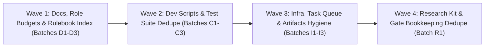

# End-to-End Deduplication Implementation Plan & Revalidation Proofs (2026-11-14)

**Status:** REVIEW REQUESTED FROM CLAUDE LOGIN C (`REVIEWED:2026-11-14 T0-ONLY` — Producer: `gemini-laptop` / Gemini 4 Argon; independent Claude Login C review required per `GEMINI_START.md` rule 7).
**Base commit:** `origin/fast-track` `5cef7cf20` (2026-11-14).
**Governing architectural decisions:**
1. **`d-dedupe-lean-no-contradiction` (`OPERATOR_DECISIONS.md:1333–1338`)**: (a) Newer dated operator decision wins; (b) live code/trunk behavior beats a doc (fix the doc unless the doc is a newer operator decision); (c) later-commit doc beats earlier doc (loser shrinks to a one-line pointer to the winner); (d) deletion requires `git grep -w <name>` showing zero live callers and tests passing.
2. **`d-simplify-align-s0` (`ANNOUNCEMENTS.md` A-20261030-1 / `D7_ROADMAP.md`)**: Machinery stays as built and does not grow (no new roles, pages, rule docs, vendors, lanes, or dashboards). Prefer deleting or pointing over adding modules.
3. **`ARCH_REVIEW_2026-11-10.md` & `SHIP_ARCH_REVIEW_2026-11-12.md` ("Deductions Architecture", $V - C$ score)**:
   - Operator approved all 8 ship-architecture changes on 2026-11-12 (`OPERATOR_DECISIONS.md`, commit `7a23bdd16`).
   - Fast gate (<2 min) runs locally; full suite runs on CI (4.5 min); test-list auto-discovery (`run_extra_tests.py`, commit `dda28e80c`) replaced hand-kept registration step `3gd`.
   - 7 of 12 artifacts retired (`2026-11-13 Keep only the 5 pinned pages`: keepers are `MTS Home`, `CBP Analyst Desk`, `Test Simulator`, `Buy Crypto`, `Conceptualizer`; `mts_layer_map`, `research_map`, and `tom_fabio_deck` are `status: retire`).
   - Per-device disk floor & cold move (`2026-11-14 05:32Z`, `disk_keep.py` + `disk_plan.json`) and worktree auto-cleanup (`sync.py` `b5f67b550`, `a33c86176`) are active.
   - Phase-specific context study architecture (`MTS_BRAINS_SPEC_1114.md` + `research_kit.py` + `fees.py`) governs all new edge/study scripts.

---

## 1. Executive Summary of Revalidation (All Prior Audits + New E2E Scan)

We revalidated **125 audit items** across 6 audit sources plus our own AST/filesystem scan on trunk `5cef7cf20`:
- **`DOCS.md` (24 rows, 2026-10-28)**: **8 applied** in batches 1–3; **2 superseded**; **14 still open** on trunk.
- **`INFRA.md` (24 rows, 2026-10-28)**: **7 applied** in batches 1–5; **3 superseded** by 11-13/11-14 architecture changes; **14 still open** on trunk.
- **`CODE.md` (33 rows in 2026-10-28 AST audit + 24 rows in 2026-10-29 audit)**: **12 applied** (dead defs removed in batches 3–5, `OWN_TEMP_PREFIXES` unified, `make_planner_data.py` deleted, `AGY = find_agy()` unified, `test_tasks_stale.py` & `test_aibridge_*` consolidated); **45 combined rows evaluated**, with **26 actionable open items** remaining.
- **`ARCH_REVIEW_2026-11-10.md` (12 cuts) & `SHIP_ARCH_REVIEW_2026-11-12.md` (8 changes)**: Ship changes 1–7 landed (`7a23bdd16`, `dda28e80c`, `0b5e71980`), but **5 structural deduplication cuts remain unfinished** on disk (`468` closed cards still in live `MyTradingSys/system/tasks/`, `39` dated one-off plan docs in `MyTradingSys/system/`, `36` `LAYERS.md` commits in 24h, `97` worktrees with unshipped work, and 8 open verification questions in `SHIP_CHANGES_1_8_REVIEW_REQUEST_2026-11-13.md`).
- **2026-11-14 Gemini Contradiction Scans & `mts_doctor.py` (`REPORT_2026-11-14.md`)**:
  - `indicator_rulebooks/INDEX.md`: **7 false `PARTIAL`/`MISSING` rows** where complete 8-section rulebooks exist on disk (`RSI.md`, `MOVING_AVERAGES.md`, `STOCH_RSI.md`, `CVD.md`, `FUNDING_LS.md`, `TREND_LINES.md`, `HILEGA_MILEGA.md`).
  - Routing/Device docs (`ROUTING.md`, `HOW_MTS_RUNS.md`, `WORKERS.md`, `DEVICES.md`, `YT_PROXY.md`, `GEMINI.md`, `GEMINI_LAPTOP_PLAN_1114.md`, `SUPER_SESSION.md`, `PLAN_24H_2026-11-14.md`): **11 active doc contradictions** verified with exact `file:line`.
  - `mts_doctor.py` (`REPORT_2026-11-14.md`): **1 exact line duplicate** (`AGENTS.md` vs `GEMINI_START.md` YouTube caption block), **1 dead ref** (`PLAN_5H_2026-10-19.md:28`), **20 `DUP-CARD` pairs**, and **20 `CARD` lint warnings** (including 3 void review stamps ending in `;` or `.`).
- **New Own Findings (AST & Filesystem Scan on `5cef7cf20`, 2,145 `.py` files)**:
  - **6 exact byte-for-byte duplicate Python study libraries** across `MyTradingSys/research/` (10 redundant file copies, including `rsi_grid_lib.py` copied 5 times byte-for-byte across 5 directories).
  - **15 AST-identical functions copied 4–9 times** across `MyTradingSys/research/` (`fetch.py:get` 9x, `wilder_rsi` 7x, `fwd_window` 7x, `fwd_exit` 5x, `adx_di` 5x) and **6 SyntaxWarnings** (unescaped `\M` and `\{` in docstrings/f-strings in `nk*`/`combo-edge-miner` scripts).
  - **Cost & Lookahead Gate Bookkeeping Bloat**: `scripts/dev/lookahead_allowlist.tsv` has grown to **787 lines** and `T06/costs.csv` to **277 lines**, causing repeated trunk CI red/revert cycles (`5cef7cf20`, `f96368ef9`, `74325de33`) whenever workers copy-paste study templates instead of importing `MyTradingSys/backtest/fees.py` and `MyTradingSys/backtest/research_kit.py`.
  - **5 shared test basenames** existing simultaneously in `scripts/dev/` and `MyTradingSys/tests/`: `test_cbp_scorecard.py`, `test_coord_overhead.py`, `test_role_hook_launcher.py`, `test_tom_noise_units.py`, `test_verdicts.py`.
  - **14 AST-identical helper groups across `scripts/dev/*.py`** (e.g., `utcnow` 10x, `iso_now` 3x, `_flags` 3x, Registry `installed_command`/`uninstall` 2x in `c_drive_guard.py` & `logon_wake.py`, YouTube SSL/proxy/time helpers 2x across `fetch_captions_timed.py`, `yt.py`, `yt_mirrors.py`, `yt_tor.py`, `yt_transcript_sites.py`).

---

## 2. Revalidation Matrix & Proofs of Previous Audits

Every command below was executed on `DESKTOP-F7IU69N` in `mts-gemini` at `origin/fast-track` `5cef7cf20` on `2026-11-14`.

### 2A. `DOCS.md` (24 rows) — Current State & Proofs

| Row | Topic | Status on `5cef7cf20` | Live Proof (`git grep` / file:line) | Action in Plan |
|---|---|---|---|---|
| 1 | Workers = background Agents (`supervisor.md` vs `WORKERS.md`/`SUPER_SESSION.md`) | **PARTIAL** (Batch 1 applied docs, but code conflicts) | `ROUTING.md:9` says workers are Agents; `scripts/dev/tasks.py:309-310` still rejects `worker="agent"` when `size != "S"` or `est_turns > 30` | Wave 1 (Batch D1): align `tasks.py:309` with `WORKERS.md:20` (allow `S` or `M` with `est_turns <= 30`) |
| 2 | `model_guard.py` / `turn_meter.py` references | **DONE** (Batch 1) | `ls scripts/dev/model_guard.py scripts/dev/turn_meter.py` -> absent; removed in `583fafb9c` | None |
| 3 | `supervisor.py` `SPAWN Pipeliner` string | **DONE** | `git grep "SPAWN Pipeliner" scripts/dev/supervisor.py` -> 0 hits | None |
| 4 | `Pipeliner` vs `Lead (pipeline mode)` ownership of `ROUTING.md` | **OPEN** | `ROUTING.md:1,4-5,90-91`, `SUPER_SESSION.md:89`, `roles/supervisor.md:70-71` still say `Pipeliner owns it` / `start a second Pipeliner` | Wave 1 (Batch D2): update to `Lead (pipeline mode)` |
| 5 | `roles/builder.md:5` start line | **DONE** (Batch 2) | Applied in `8f2e3beab` | None |
| 6 | Weekly cap `85%` vs `95%` for Login C | **OPEN (New drift 11-14)** | `OPERATOR_DECISIONS.md:2552` (`227da3bd9`) raised Login C cap to `95%`, but `SUPER_SESSION.md:82,113`, `PLAN_24H_2026-11-14.md:3,6`, and `scripts/dev/supervisor.py:979` still state `85%` | Wave 1 (Batch D1): point docs to `supervisor.py:weekly_cap` and align Login C cap |
| 7 | `SCHEDULING_POLICY.md` 4b3 `MTS-SuccWake` vs `supervisor.md` | **SUPERSEDED** | `SCHEDULING_POLICY.md:33` (`d-headless-wake-bug`, 2026-10-30) retired `MTS-SuccWake` as default; only `--wake` or 4d `MTSLogonWake` uses it | Wave 1 (Batch D2): ensure `supervisor.md` and `SCHEDULING_POLICY.md:1-7` state the 4b3/4d rule once |
| 8 | Supervisor start phrase (`ROSTER.json` vs `supervisor.md` vs `SUPER_SESSION.md:136`) | **OPEN** | `SUPER_SESSION.md:136` still carries a 3rd copy `You are Supervisor. Run the super session...`; `supervisor.md:9` carries its own copy | Wave 1 (Batch D2): point `SUPER_SESSION.md:136` and `supervisor.md:9` to `ROSTER.json:6` |
| 9 | `HEARTBEAT_MIN = 75` vs literal strings | **DONE** (Batch 1) | `supervisor.py` uses `HEARTBEAT_MIN` | None |
| 10 | Rotation trigger `150K` (Lead) vs `200K` (Coordinator) & `REQUIREMENTS.md:19` C-03 | **OPEN** | `REQUIREMENTS.md:19` still lists `C-03` as open disagreement; `SUPER_SESSION.md:47` says `~200K` vs `:52` `--context-tokens >= 150000` | Wave 1 (Batch D2): resolve C-03 in `REQUIREMENTS.md:19` and unify `SUPER_SESSION.md:47,52` |
| 11 | `Researcher` role in `WORKERS.md:46` vs `ROSTER.json` | **OPEN** | `WORKERS.md:46` names `Researcher` in brief template; `ROSTER.json` has no `Researcher` role | Wave 1 (Batch D2): replace `Researcher` in `WORKERS.md:46` with `all worker roles` (per S0 freeze: no new roles) |
| 12 | `builder.md:2` `SUPERVISOR.md` stub pointer | **DONE** (Batch 2) | Applied in `8f2e3beab` | None |
| 13 | `RUN_MODEL.md` superseded header | **DONE** (Batch 3) | Applied in `bd8c40f85` | None |
| 14 | `ARCHITECTURE.md` Pipeliner note | **DONE** (Batch 3) | Applied in `bd8c40f85` | None |
| 15–23 | Duplicate brief templates, Opus rule, heartbeat, alias list, 45m stuck worker, pages-follow-builds across `supervisor.md`, `SUPER_SESSION.md`, `WORKERS.md`, `lead.md` | **OPEN** | `roles/supervisor.md` is at **7,697 / 7,700 B (0.0% headroom, 3 bytes left!)** (`REPORT_2026-11-14.md:7`); `eagle_eyes.md` is at `7,082 / 7,100 B` (0.3% headroom); `CLAUDE.md` is at `7,153 / 7,168 B` (0.2% headroom) | Wave 1 (Batch D3): replace duplicate blocks in `roles/supervisor.md`, `roles/lead.md`, and `SUPER_SESSION.md` with 1-line pointers to `WORKERS.md`, reclaiming >600 B of role-budget headroom |
| 24 | `ROUTING.md` C4 pointer to `roles/eagle_eyes.md:60` | **DONE** (Batch 2) | `ROUTING.md:106` cites `roles/eagle_eyes.md:60` | None |

### 2B. `INFRA.md` (24 rows) — Current State & Proofs

| Row | Topic | Status on `5cef7cf20` | Live Proof (`git grep` / file:line) | Action in Plan |
|---|---|---|---|---|
| 1 | Worktree cleanup trigger (`wt_maint.py` scheduled task vs `c_drive_guard.py` hook + `sync.py` auto-cleanup) | **OPEN** | `DEVICE_TASKS.json:24` still lists `wt-maint`, `SCHEDULING_POLICY.md:26,60` and `DEVICES.md:121,148` still document the scheduled task, while `STATION_CLEANUP.md:79` and `sync.py` (`b5f67b550`) do it without a scheduler | Wave 3 (Batch I1): update `DEVICE_TASKS.json`, `SCHEDULING_POLICY.md`, and `DEVICES.md` to reflect hook/sync-driven cleanup |
| 2–3 | `SCHEDULING_POLICY.md` exceptions table & `ALLOWED_TASKS` (`MTS-SuccWake-`) | **DONE** (Batch 1) | Applied in `022aae906` / `18f561d33` | None |
| 4–5 | Retired scheduler `.ps1` scripts in `scripts/sched/` (7 scripts + `test_sched_scripts.py` + `c_drive_care.ps1`) | **OPEN** | `glob.glob("scripts/sched/*.ps1")` -> 7 files; `scripts/dev/c_drive_care.ps1` -> True; `scripts/dev/test_sched_scripts.py` -> True | Wave 3 (Batch I1): execute `retire-relay-machinery` — archive retired `.ps1` installers and `test_sched_scripts.py` |
| 6 | Three process kill policies (`host_health.py` vs `c_drive_guard.py` vs `runaway_check.ps1`) | **OPEN** | `host_health.py:35` (`STRAY_CPU_S = 3600`), `runaway_check.ps1` (`600` CPU-s), `c_drive_guard.py` (`24h` shells) | Wave 3 (Batch I1): document single threshold table in `STRAY_REAP_POLICY.md` and point `c_drive_guard.py` docstring to `host_health.py` |
| 7–9 | `OWN_TEMP_PREFIXES`, `ARCHITECTURE.md` hook list, `offer_guard` note | **DONE** (Batches 2–3) | Verified in `test_host_health.py:213-214`, `ARCHITECTURE.md`, `OPERATOR_DECISIONS.md` | None |
| 10 | Per-device status tables in `STATION_CLEANUP.md` & `DEVICES.md` vs `device_tasks.py` & `disk_plan.json` | **OPEN** | `grep -c "NOT CAPTURED" MyTradingSys/system/STATION_CLEANUP.md` -> 6 lines; `MyTradingSys/system/disk_plan.json` added on 11-14 (`05:32Z`) | Wave 3 (Batch I2): replace static `NOT CAPTURED` table in `STATION_CLEANUP.md` with pointer to `device_tasks.py matrix` and `disk_keep.py status` |
| 11 | `ANNOUNCEMENTS.md` duplicate ID `A-20261024-1` and expired cleanup entries | **DONE** (Batch 1) | `ANNOUNCEMENTS.md:75,82,89` moved to EXPIRED and renumbered `A-20261024-2` | None |
| 12 | `mts_signal.py` `send --kind broadcast` vs `broadcast` subcommand | **DEFERRED (Unsafe alone)** | `mts_signal.py:1404` still allows `--kind broadcast` because `spawn_send` uses it (`INFRA.md:54`) | Wave 2 (Batch C3): refactor `spawn_send` to call `broadcast` path with ID, then remove `broadcast` from `send --kind` |
| 13 | `RELAY_NOTES.md` N001–N003 `status=open` since 2026-10-19 | **OPEN** | `git grep -n "status=open" MyTradingSys/system/RELAY_NOTES.md` -> 3 hits (lines 10, 14, 17) | Wave 3 (Batch I2): close N001–N003 via `relay_board.py close` |
| 14 | Root `handover/` folder vs `MyTradingSys/system/handover/` | **DONE** (Batch 3) | Root `handover/` moved to `handoff_history/` in `bd8c40f85` | None |
| 15 | `roles/lead.md:14,31` `handover/LEAD.md` vs `LEAD_RESUME_<date>.md` | **OPEN** | `git grep -n "handover/LEAD.md" MyTradingSys/system/roles/lead.md` -> lines 14, 31 | Wave 1 (Batch D2): align `roles/lead.md:14,31` with `supervisor.py` `LEAD_RESUME_<date>.md` |
| 16 | `NEXT_SESSION.md` stacked blocks | **DONE** | `git grep -c "^# NEXT SESSION" MyTradingSys/system/NEXT_SESSION.md` -> 0 stacked blocks | None |
| 17 | One-shot `PILOT3_*` files in `handover/` | **DONE** (Batch 4) | Moved to `handoff_history/` in `e62bb1eb6` | None |
| 18 | Dated one-shot plan/brief docs in `MyTradingSys/system/` (`ARCH_REVIEW_2026-11-10` row 10) | **OPEN (39 dated files)** | `pathlib.Path("MyTradingSys/system").glob("*2026*")` -> **39 files** (including 18 expired `PLAN_*` files from Oct/early Nov) | Wave 3 (Batch I2): move expired Oct/early-Nov one-shot `PLAN_*`, `HOST_WORKTREES_2026-10-15`, `LEFTOVERS_2026-10-15`, `WATCHER_TASKS_2026-10-25` to `MyTradingSys/system/handoff_history/` (after checking no active task card references them) |
| 19–22 | `artifacts/registry.json` (`cbp_desk`, `unpinned_old`, `artifacts/README.md` owner `jishu.sharma`) | **OPEN + UPDATED BY 11-13 DECISION** | On 2026-11-13 (`Keep only the 5 pinned pages`), 7 pages were retired (`research_map`, `mts_layer_map`, `tom_fabio_deck` set to `status: retire`). Still open: `artifacts/README.md:22,27,42-53` still names `jishu.sharma` instead of `jishusharma1985` (Login C), and `registry.json:471` still carries `unpinned_old` | Wave 3 (Batch I3): update `artifacts/README.md` to `jishusharma1985` and 5 keeper pages; drop `unpinned_old` from `registry.json`; update `test_artifact_fixes.py` alongside `cbp_desk` cleanup |
| 23 | Duplicate layer-map generators: `make_layer_map.py` vs `make_layers_board.py` | **SUPERSEDED BY 11-13 DECISION (Both pages retired!)** | `OPERATOR_DECISIONS.md` (2026-11-13): `mts_layer_map` is retired (`status: retire`); `make_layers_board.py` is already noted as unused, while `make_layer_map.py` + `test_make_layer_map.py` (`extra_tests.tsv:82`) still run in tests | Wave 2 (Batch C1): retire `make_layer_map.py`, `layer_map.tpl.html`, `artifacts/layer_map.html`, and `test_make_layer_map.py` (keep `LAYERS.md` and `layer_map.json` which backtest/gate tools read) |
| 24 | `DEVICES.md:146` dirty worktree rule pointer | **DONE** (Batch 2) | Applied in `8f2e3beab` | None |

### 2C. `CODE.md` (Both 2026-10-28 32-row & 2026-10-29 24-row versions) + New Own Code Findings

| ID | Category | Duplicate Components (Verified on `5cef7cf20`) | Proof / Count | Consolidation Target |
|---|---|---|---|---|
| **C-01** | Safety / Secret Redaction | `scripts/dev/testnet_canary.py:66-74` (`_KW`, `_ORDER`, `_PLAN`, `_DIGITS`, `_TOKEN`, `BRAKE_FILES`, `TS_FMT`, `scrub()`) vs `scripts/dev/testnet_status.py:32-43` (identical regexes & 5-line `scrub()`) | `git grep -n "def scrub(" scripts/dev` -> 2 files | Import `scrub`, `BRAKE_FILES`, `TS_FMT` from `testnet_status.py` into `testnet_canary.py`; add test asserting both redact `api_key=...` |
| **C-02** | Shared Test Basenames (5 pairs) | 5 test files exist with the **exact same filename** in both `scripts/dev/` and `MyTradingSys/tests/`: 1. `test_verdicts.py` (305L vs 143L) 2. `test_cbp_scorecard.py` 3. `test_coord_overhead.py` 4. `test_role_hook_launcher.py` 5. `test_tom_noise_units.py` Plus `scripts/dev/test_check_sourced_params.py` vs `MyTradingSys/tests/test_sourced_rule_guard.py` and `scripts/dev/test_sync_push_race.py` (19L) vs `test_sync.py` | `scan_own_findings.py`: 5 exact basename collisions between `scripts/dev/test_*.py` and `MyTradingSys/tests/test_*.py` | Merge each pair into its canonical location (`scripts/dev/test_<script>.py` for dev scripts; `MyTradingSys/tests/` for domain/backtest), delete the shadow file, and let `run_extra_tests.py` auto-discovery pick it up |
| **C-03** | Time & Subprocess Helpers (`scripts/dev/`) | - `utcnow()` AST-identical in **10 files**: `cicd_run.py:95`, `codex_run.py:102`, `dsa.py:67`, `fetch_captions_timed.py:114`, `lane_health.py:57`, `live_owner.py:41`, `mts_run.py:55`, `mts_signal.py:247`, `yt.py:105`, `yt_mirrors.py:145` - `iso_now()` AST-identical in **3 files**: `desk.py:54`, `shot.py:141`, `tasks.py:80` - `_flags()` (`CREATE_NO_WINDOW`) AST-identical in **3 files**: `lease.py:69`, `role_loader.py:119`, `traffic.py:32` - `_parse(s)` / `_utc(s)` in `successor_wake.py:109` vs `supervisor.py:960` | AST scan: `10x`, `3x`, `3x`, `2x` exact AST body matches | Export `utcnow()`, `iso_now()`, `TS_FMT`, and `_flags()` from `scripts/dev/traffic.py` (already imported by `supervisor.py`); import where tests do not monkeypatch the module-local clock |
| **C-04** | Shared Constants (`scripts/dev/`) | - `LIVE_MARKER = ".mts_live"` in **6 files**: `sync.py:51`, `c_drive_guard.py:178`, `desk.py:41`, `dsa.py:34`, `live_mirror.py:39`, `make_status.py:301` (+ duplicate `is_live` / `is_live_tree` in `dsa.py:118` and `make_status.py:304`) - `CLAIMS_DIR = "MyTradingSys/system/claims"` in **3 files**: `sync.py:55`, `desk.py:230`, `dsa.py:37` - `GATEWAY_MARKER = ".gateway_owner"` in **2 files**: `sync.py:52`, `dsa.py:36` - `STALE_CLAIM_H = 24` in `desk.py:234` vs `sync.py:61` `STALE_HOURS = 24` - `HANDOVER_REL` in **3 files**: `supervisor.py:955`, `role_loader.py:206`, `successor_wake.py:30` - `LIVE_HOST_FILE` in **2 files**: `live_mirror.py:40`, `supervisor.py:943` | `revalidate_dedupe.py` exact line counts: `6x`, `3x`, `2x`, `2x`, `3x`, `2x` | Export `LIVE_MARKER`, `CLAIMS_DIR`, `GATEWAY_MARKER`, `STALE_HOURS`, `TRUNK`, `is_live_tree()` from `scripts/dev/sync.py`; export `HANDOVER_REL` from `supervisor.py` and `LIVE_HOST_FILE` from `live_mirror.py` |
| **C-05** | Process & Claim Helpers (`scripts/dev/`) | - `pid_alive()` duplicated in **3 files**: `sync.py:145` (robust `ctypes` `OpenProcess` handling `ERROR_ACCESS_DENIED`), `c_drive_guard.py:32` (`ctypes`), `codex_run.py:28` (slow `tasklist.exe` subprocess) - `stale_claims()` duplicated in **3 files**: `mts_doctor.py` (uses `sync.open_claims`), `health_audit.py` (shells out to CLI), `status_board.py` (regex parse) - `gate_jobs()` in `run_all_tests.py:400` vs `jobs()` in `run_extra_tests.py:95` - `ids(t)` in `run_all_tests.py:498` vs `test_ci_split.py:68` | `revalidate_dedupe.py`: verified all 4 groups on disk | Import `sync.pid_alive` in `c_drive_guard.py` & `codex_run.py`; import `sync.open_claims` in `health_audit.py` & `status_board.py`; share `gate_jobs()` and top-level `ids(t)` from `run_all_tests.py` |
| **C-06** | YouTube & Registry Helpers (`scripts/dev/`) | - `fetch_captions.py` (120L) vs `fetch_captions_timed.py` (241L superset) - AST-identical helpers across `fetch_captions_timed.py`, `yt.py`, `yt_mirrors.py`, `yt_tor.py`, `yt_transcript_sites.py`: `proxy_dir` (2x), `_port_open` (2x), `_ssl_context` (2x), `_iso` (2x), `_t`/`_rt` (3x) - `installed_command()` and `uninstall()` AST-identical in `c_drive_guard.py:761,792` and `logon_wake.py:175,205` - `ext_id_for_path()` in `aibridge_install.py` and `aibridge_verify.py` - `sha256()` in `declutter_backups.py:28` and `deploy_untrack_backup.py:38` | `scan_own_findings.py` AST match output | Make `fetch_captions.py` delegate to `fetch_captions_timed.py`; share `proxy_dir`/`port_open` from `yt_tor.py` and `_ssl_context`/`_iso`/`_t` from `yt_mirrors.py`; share `ext_id_for_path` via `aibridge_version.py`; import `sha256` from `declutter_backups.py` |

### 2D. New Own Findings: Research Study Duplication & Gate Bookkeeping (`MyTradingSys/research/`)

Our AST and hash scan (`scan_own_findings.py`) uncovered a major new source of duplication created during the Nov 13–14 high-velocity edge search:
1. **6 Byte-for-Byte Identical Python Files Across Research Folders**:
   - `rsi_grid_lib.py` (`sha256[:16] = 510b76017b718b53`, 155 lines: `wilder_rsi`, `fold`, `episodes`, `confirm_info`, `rsi_at_hours`, `fwd_window`, `fwd_first`, `fwd_exit`, `sma`, `adx_di`) is copied **5 times byte-for-byte** in:
     - `MyTradingSys/research/rsi_4h_exits_newcoins_2026-11-13/rsi_grid_lib.py`
     - `MyTradingSys/research/rsi_confirm_layers_2026-11-13/rsi_grid_lib.py`
     - `MyTradingSys/research/rsi_htf_extreme_2026-11-13/rsi_grid_lib.py`
     - `MyTradingSys/research/rsi_htf_power_2026-11-13/rsi_grid_lib.py`
     - `MyTradingSys/research/rsi_oi_unwind_newcoins_2026-11-13/rsi_grid_lib.py`
   - `htf_lib.py` (`f91d626ec0739630`) is copied **2 times** (`rsi_htf_extreme_2026-11-13/htf_lib.py`, `rsi_htf_power_2026-11-13/htf_lib.py`).
   - `trend_lib.py` (`a9eae307fea32138`) & `universe.py` (`eb4377426acf9c41`) are copied **2 times** (`daily_trend_follow_2026-11-13/` and `long_gated_trend_newcoins_2026-11-14/`).
   - `mal_div_lib.py` (`b32487c7e7ce02e0`) is copied **2 times** (`malkan_divergence_r03_r04_2026-11-13/` and `mined_rules_nk_mal_cbp_2026-11-14/`).
   - `study.py` / `parent_study.py` (`ff516841e839a10a`) is copied **2 times** (`ny_session_value_return_2026-11-13/` and `ny_value_poc_target_2026-11-13/`).
2. **Why this hurts trunk (Root Cause of Nov 14 CI Reds)**:
   - Because each study copies `fwd_window` / `fwd_exit` and defines its own `FEE_RT` / `TAKER_BPS` constants instead of importing `MyTradingSys/backtest/fees.py` and `MyTradingSys/backtest/research_kit.py`, **every new study triggers `test_no_own_costs.py` (Step 4e) and `lookahead_lint.py` (Step 3la)**!
   - Proof from `git log -n 40 --oneline` today (2026-11-14): commits `5cef7cf20` (revert `maker-entry-1114` 5 commits), `f96368ef9` / `c8e9450c5` (revert `T3` merge), `74325de33` (allowlist `T9` and `T1`), `1b40fea4e` (allowlist `NKN-01`/`NKN-06`), `e1476b60c` (rename `T4` constants) were all caused by copied cost constants and copied forward-window helpers.
3. **6 Python 3.14 `SyntaxWarning`s in `MyTradingSys/research/`**:
   - Unescaped `\M` and `\{` in `combo-edge-miner-1114_2026-11-14/fetch.py:1`, `nk2-pivot-sr-reclaim-1114_2026-11-14/fetch_15m.py:1`, `nk4-hilega-milega-recon-1114_2026-11-14/fetch_vision.py:2`, `nk6-confluence-combos-1114_2026-11-14/fetch.py:1,26`, `nk6-confluence-combos-1114_2026-11-14/make_result.py:63`.

---

## 3. Phased End-to-End Implementation Plan

In accordance with `apply-dedupe-audit-findings` (batches of $\le 10$ items, `run_all_tests.py --quick` green after each batch, one ship per batch, zero live-tree/process changes, `CLAUDE.md` untouched for size cap), the work is organized into **4 Waves (10 Batches)**:

### Wave 1: Instruction Docs, Role Budget Headroom & Rulebook Index (Batches D1–D3)

- **Batch D1 — Live Contradictions in Routing, Devices, Workers & Weekly Caps (8 items)**:
  1. `MyTradingSys/system/HOW_MTS_RUNS.md:21,22,27-29`: Fix 4 stale conflicts against `ROUTING.md` (`2026-11-14`): (a) replace `MTS-AutoDeploy` with manual/coordinator deploy (`DEPLOY_RUNBOOK.md`); (b) update Gemini model column from `UNVERIFIED` to `Flash / Argon (agy.exe)`; (c) mark `DSA / DSA-NB / DSA-NUC` as `CLOSED under standing operator hold`.
  2. `MyTradingSys/system/DEVICES.md:54` vs `ROUTING.md:76`: Clarify live loop host cutover note (`live_host.txt` / `LIVE_HOST_MOVE.md`) so `DEVICES.md` and `ROUTING.md` do not contradict on where live checks run.
  3. `scripts/dev/tasks.py:309-310`: Align `worker == "agent"` lint with `WORKERS.md:20` and `ROUTING.md:9` (allow `size in ("S", "M")` when `est_turns <= AGENT_MAX_TURNS`), adding a fail-first test in `scripts/dev/test_tasks.py`.
  4. `MyTradingSys/system/YT_PROXY.md:51` & `ROUTING.md:86,88`: Remove withdrawn Path 3 draining reference in `YT_PROXY.md:51` and consolidate duplicate YouTube caption routing rows (`gemini_1114b/diffreview-system-docs` row 1).
  5. `GEMINI.md:10` & `AGENTS.md` / `GEMINI_START.md`: Update `GEMINI.md:10` to reference `GEMINI_START.md` rule 8 (`SOLO` ship vs `REVIEW` branch push); replace duplicate `YouTube caption block` line in `GEMINI_START.md:5` with a pointer to `AGENTS.md` (fixes `mts_doctor.py` `[DUPLICATE]` finding).
  6. `MyTradingSys/system/GEMINI_LAPTOP_PLAN_1114.md:21,31,34-35,42`: Align `:low:hydrogen` / `:medium:flash` and `max 3` across lines 21, 31, 42, and replace `gh run list` on laptop with `ci_watch.py` (`diffreview-system-docs` rows 2–3).
  7. `MyTradingSys/system/SUPER_SESSION.md:82,113` & `PLAN_24H_2026-11-14.md:1-51`: Update Login C weekly cap reference to `95%` (per `OPERATOR_DECISIONS.md:2552`) and add required `| A |`, `| B |`, `| C |` Link rows to `PLAN_24H_2026-11-14.md` (fixes `DOC-DRIFT` bug in `test_super_session_doc.py`).
  8. `MyTradingSys/system/PLAN_5H_2026-10-19.md:28`: Fix or archive dead reference to untracked `MyTradingSys/system/tasks/ci-919cc0f.json` (fixes `mts_doctor.py` `[DEAD-REF]` finding).

- **Batch D2 — `DOCS.md` Open Conflicts (Rows 4, 7, 8, 10, 11, 15 + `INFRA.md` Row 15) (7 items)**:
  1. `ROUTING.md:1,4-5,90-91`, `SUPER_SESSION.md:89`, `roles/supervisor.md:70-71`: Change `Pipeliner` ownership wording to `Lead (pipeline mode)` (`DOCS.md` row 4).
  2. `roles/supervisor.md:53` & `SCHEDULING_POLICY.md:1-7`: Point `supervisor.md` handover line to `SUPER_SESSION.md` End (`--wake` opt-in only per `d-headless-wake-bug`) (`DOCS.md` row 7).
  3. `roles/supervisor.md:9` & `SUPER_SESSION.md:136`: Replace duplicate Supervisor start-line copies with a pointer to `ROSTER.json:6` (`DOCS.md` rows 8, 15).
  4. `SUPER_SESSION.md:47,52` & `REQUIREMENTS.md:19`: Label Lead rotation (`150K`) vs Coordinator rotation (`200K`) and mark `REQUIREMENTS.md` `C-03` resolved (`DOCS.md` row 10).
  5. `WORKERS.md:46`: Remove unrostered `Researcher` role name from brief template (`DOCS.md` row 11).
  6. `roles/lead.md:14,31`: Point Lead handover filename to `handover/LEAD_RESUME_<date>.md` to match `supervisor.py:1331` (`INFRA.md` row 15).
  7. `scripts/dev/role_loader.py` & `ROLES.md:21`: Render `ALIASES` from `ROSTER.json` so `ROLES.md` and `ROSTER.json` cannot drift (`DOCS.md` row 19).

- **Batch D3 — Role Budget Headroom & Indicator Rulebook Index (8 items)**:
  1. **Reclaim >600 B in `roles/supervisor.md` (currently 7,697 / 7,700 B — 3 bytes left!)**, `roles/eagle_eyes.md` (`7,082 / 7,100 B`), and `roles/builder.md` (`1,755 / 1,800 B`) by replacing duplicated brief templates, Opus rule restatements, 45-min stuck-worker rules, and "never ask the operator" paragraphs with 1-line pointers to `WORKERS.md` and `SUPER_SESSION.md` (`DOCS.md` rows 16, 17, 18, 20, 21, 22, 23).
  2. **`MyTradingSys/research/indicator_rulebooks/INDEX.md` (7 rows)**: Update rows 2 (`RSI`), 6 (`Moving averages`), 8 (`Stochastic RSI`), 10 (`CVD / taker delta`), 12 (`Funding and long/short ratio`), 15 (`Trend lines`), and 18 (`Hilega Milega`) from `PARTIAL`/`MISSING` to `DONE` and link their existing 8-section rulebook files (`RSI.md`, `MOVING_AVERAGES.md`, `STOCH_RSI.md`, `CVD.md`, `FUNDING_LS.md`, `TREND_LINES.md`, `HILEGA_MILEGA.md`), verified by `python scripts/dev/rulebook_check.py`.

### Wave 2: Dev Scripts & Test Suite Deduplication (Batches C1–C3)

- **Batch C1 — Retire Obsolete Generators & Consolidate Duplicate Test Files (8 items)**:
  1. Retire `scripts/dev/make_layer_map.py`, `scripts/dev/layer_map.tpl.html`, `MyTradingSys/system/artifacts/layer_map.html`, and `scripts/dev/test_make_layer_map.py` (`CODE.md` row 11 / `INFRA.md` row 23; both `layer_map.html` and `mts_layer_map` are retired).
  2. Consolidate the **5 shared-basename test file pairs** (`test_verdicts.py`, `test_cbp_scorecard.py`, `test_coord_overhead.py`, `test_role_hook_launcher.py`, `test_tom_noise_units.py`) so each test suite lives in one canonical file (`CODE.md` row 1/32 + own AST scan).
  3. Consolidate `MyTradingSys/tests/test_sourced_rule_guard.py` into `scripts/dev/test_check_sourced_params.py` (`CODE.md` row 13).
  4. Merge 19-line `scripts/dev/test_sync_push_race.py` into `scripts/dev/test_sync.py` (`CODE.md` row 22).

- **Batch C2 — Safety Redaction, Constants & Core Helpers in `scripts/dev/` (8 items)**:
  1. `testnet_canary.py` & `testnet_status.py`: Deduplicate `scrub()`, `_KW.._TOKEN`, `BRAKE_FILES`, `TS_FMT` (`CODE.md` 32-row #2) with a fail-first redaction unit test.
  2. `sync.py` constants: Import `LIVE_MARKER`, `CLAIMS_DIR`, `GATEWAY_MARKER`, `STALE_HOURS`, and `is_live_tree()` from `sync.py` into `c_drive_guard.py`, `desk.py`, `dsa.py`, `live_mirror.py`, and `make_status.py` (`CODE.md` 32-row #21–23, #26).
  3. `supervisor.py` & `live_mirror.py` constants: Import `HANDOVER_REL` from `supervisor.py` into `role_loader.py` and `successor_wake.py`; import `LIVE_HOST_FILE` from `live_mirror.py` into `supervisor.py` (`CODE.md` 32-row #18, #24).
  4. `role_loader.py` vs `role_hook_launcher.py`: Add equality assertion test `assert role_loader.PREFIX == role_hook_launcher.PREFIX` (`CODE.md` 32-row #19, keeping launcher zero-import).
  5. `pid_alive()`: Import `sync.pid_alive` in `c_drive_guard.py` and `codex_run.py` (dropping slow `tasklist.exe` call in `codex_run.py`, `CODE.md` 24-row #5).
  6. `stale_claims()`: Make `health_audit.py` and `status_board.py` call `sync.open_claims` in-process instead of shelling out or regex-parsing (`CODE.md` 24-row #7).
  7. `run_all_tests.py` & `run_extra_tests.py`: Share `gate_jobs()` and module-level `ids(t)` (`CODE.md` 32-row #15–16).
  8. `traffic.py` time/flag helpers: Export `utcnow()`, `iso_now()`, and `_flags()` from `traffic.py` and import into `lease.py`, `role_loader.py`, `desk.py`, `shot.py`, and `tasks.py` (checking test monkeypatches first, `CODE.md` 32-row #11–14).

- **Batch C3 — YouTube, AIBridge, Registry & Signal Helper Deduplication + Recent Diff Fixes (7 items)**:
  1. `fetch_captions.py`: Wrap `fetch_captions_timed.py` so caption fetching has one implementation (`CODE.md` 24-row #2).
  2. YouTube helpers: Share `proxy_dir` / `port_open` from `yt_tor.py` into `fetch_captions_timed.py`, and `_ssl_context` / `_iso` / `_t` from `yt_mirrors.py` (`scan_own_findings.py`).
  3. HKCU Run helpers: Share `installed_command()` and `uninstall()` between `c_drive_guard.py` and `logon_wake.py` (`scan_own_findings.py`).
  4. `aibridge_version.py`: Share `ext_id_for_path()` between `aibridge_install.py` and `aibridge_verify.py` (`CODE.md` 24-row #10).
  5. `declutter_backups.py`: Import `sha256()` into `deploy_untrack_backup.py` (`CODE.md` 32-row #29).
  6. `mts_signal.py`: Route `spawn_send` through the `broadcast` subcommand path (with ID) and remove `"broadcast"` from `send --kind` choices (`INFRA.md` row 12).
  7. Fix verified bugs from 2026-11-14 diff-reviews (`gemini_1114/diffreview-dev-scripts`):
     - `scripts/dev/sync.py:2264`: guard `lock.stat().st_mtime` with `try/except FileNotFoundError`.
     - `scripts/dev/ship_timing_report.py:118`: round `wait_min` once after loop instead of inside accumulation loop.
     - `scripts/dev/gemini_queue.py:308`: skip solo `sync.py ship` in `deliver()` when `p.returncode != 0`.
     - `scripts/dev/artifacts.py:648`: use `.astimezone(timezone.utc)` before `.replace(tzinfo=timezone.utc)`.

### Wave 3: Infra, Task Queue, Worktrees & Artifacts Hygiene (Batches I1–I3)

- **Batch I1 — Retired Scheduler Scripts & Kill/Cleanup Policy Alignment (6 items)**:
  1. Archive the 7 retired scheduler `.ps1` installers in `scripts/sched/`, `scripts/dev/c_drive_care.ps1`, `scripts/dev/install_backup_task.ps1`, and `scripts/dev/test_sched_scripts.py` (`INFRA.md` rows 4–5, `ARCH_REVIEW_2026-11-10` row 10).
  2. Update `DEVICE_TASKS.json` (`wt-maint`), `SCHEDULING_POLICY.md:26,60`, and `DEVICES.md:121,148` so worktree cleanup points to `c_drive_guard.py` / `sync.py` (`INFRA.md` row 1).
  3. Unify process kill thresholds in `STRAY_REAP_POLICY.md` and point `c_drive_guard.py` docstring to `host_health.py` (`INFRA.md` row 6).
  4. Replace static `NOT CAPTURED` table in `STATION_CLEANUP.md` with pointers to `device_tasks.py matrix` and `disk_keep.py status` (`INFRA.md` row 10).

- **Batch I2 — Task Queue Sweep, Duplicate Cards & Dated System Docs (6 items)**:
  1. **Sweep 468 closed cards (`280 done`, `52 dropped`, plus archived-state files) out of `MyTradingSys/system/tasks/` into `MyTradingSys/system/tasks/archive/`** (`ARCH_REVIEW_2026-11-10` row 8 — currently 667 cards sit in the live folder!).
  2. **Resolve the 20 `DUP-CARD` pairs and 20 `CARD` lint warnings in `REPORT_2026-11-14.md:33-72`**:
     - Fix the 3 void review stamps ending in punctuation (`extract-btc-50w-ma-video-j-JVi02_C88-1112`, `nk-conceptualizer-layer-after-extracts-1113`, `pitchfork-hagopian-target-double-1113`).
     - Refresh stale scope hashes (`tasks.py tag <id> --refresh`), shorten >400-char goal lines on the 6 `gemini-edge-*` cards, and drop or link `not_twin_of` on the 20 `DUP-CARD` pairs (e.g., `gemini-edge-blind-edge-rsi-extreme-confirm-1114` vs `rederive-rsi-extreme-confirm-gemini-1114`).
  3. Close stale `RELAY_NOTES.md` N001–N003 (`relay_board.py close N001 N002 N003 --reply "superseded by cards"`, `INFRA.md` row 13).
  4. Move the expired Oct/early-Nov dated `PLAN_*` and one-shot files in `MyTradingSys/system/` (that have zero active card refs) to `MyTradingSys/system/handoff_history/` and update `03_FILE_INDEX.md` (`INFRA.md` row 18 / `ARCH_REVIEW_2026-11-10` row 10).

- **Batch I3 — Artifacts Registry Cleanup & Ship-Changes 1–8 Verification (5 items)**:
  1. Update `MyTradingSys/system/artifacts/README.md` to state `jishusharma1985` (Login C) owns all 5 active pages (`MTS Home`, `CBP Analyst Desk`, `Test Simulator`, `Buy Crypto`, `Conceptualizer`) (`INFRA.md` row 20 + 2026-11-13 decision).
  2. Remove `cbp_desk` duplicate row and `unpinned_old` block from `MyTradingSys/system/artifacts/registry.json` and update `scripts/dev/test_artifact_fixes.py` in the same commit (`INFRA.md` rows 19, 21).
  3. Close out the 8 verification items in `MyTradingSys/research/audits/SHIP_CHANGES_1_8_REVIEW_REQUEST_2026-11-13.md`:
     - Verify `tasks.py lint --warn` only demotes paperwork (DoR/review stamp) and still blocks structural corruption (missing `id` or filename mismatch).
     - Remove any remaining automatic `LAYERS.md` regeneration in `sync.py ship` (`SHIP_ARCH_REVIEW_2026-11-12` change 7 — `LAYERS.md` still had 36 commits in the last 24h!).

### Wave 4: Research Study Library Consolidation & Gate Bookkeeping Dedupe (Batch R1)

- **Batch R1 — Shared Research Primitives (`research_kit.py`) & SyntaxWarning Cleanup (6 items)**:
  1. Export canonical `wilder_rsi`, `sma`, `adx_di`, `fwd_window`, `fwd_first`, `fwd_exit`, and `binance_vision_klines_get` from `MyTradingSys/backtest/research_kit.py` (or `MyTradingSys/backtest/study_primitives.py`), tested once in `MyTradingSys/tests/test_research_kit.py` and allowlisted once in `scripts/dev/lookahead_allowlist.tsv`.
  2. Replace the **5 byte-identical copies of `rsi_grid_lib.py`**, **2 copies of `htf_lib.py`**, **2 copies of `trend_lib.py`**, **2 copies of `universe.py`**, and **2 copies of `mal_div_lib.py`** with thin re-exports from `research_kit.py` (preserving exact numerical outputs and all existing study tests).
  3. Fix the **6 Python 3.14 `SyntaxWarning`s** (unescaped `\M` and `\{` in `combo-edge-miner-1114`, `nk2`, `nk4`, `nk6`) by using raw docstrings `r"""..."""` and `Path(OUT) / f"{sym}_15m.npz"`.
  4. Prune corresponding duplicate entries in `scripts/dev/lookahead_allowlist.tsv` so new studies importing `research_kit` never need per-study allowlist commits or `costs.csv` bookkeeping commits.

---

## 4. Verification & Gate Protocol per Batch

1. **Pre-edit check**: `git grep -w <symbol>` before any deletion; verify zero live callers outside the consolidated file.
2. **Fail-first test**: Any behavioral or lint fix (e.g., `tasks.py` agent size lint, `tasks.py lint --warn` structural check, `testnet_status.scrub` import) adds a unit test verified to fail before the code edit.
3. **Gate run**: Run `python scripts/dev/run_all_tests.py --quick` + `python scripts/dev/mts_doctor.py --no-process` after each batch.
4. **Delivery**: Commit with `Result:` and `MTS-Session:` trailer, ship via `sync.py ship` (or push branch for coordinator review in REVIEW mode).
