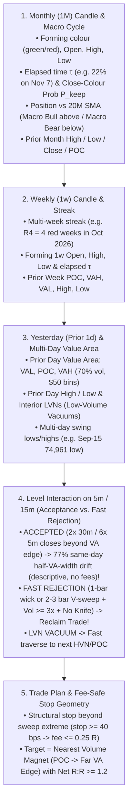

# Tom & Fabio Layers: End-to-End Audit, Root-Cause Failure Analysis, and Plain Auction-Theory Course Correction (2026-11-07)

## Executive Summary

Over the past six weeks, MTS built and tested twelve iterations of the **Tom (Auction Theory / Volume Profile)** and **Fabio (Order Flow / Effort-vs-Result / LVN)** layers—spanning Java (`SetupCandidatesBuilder.java`, `SpikeFadeDetector.java`) and Python (`tom_vp.py`, `vp_pivot_probe.py`, `vp_return_to_value.py`, `fabio_of_model.py`, `fabio/v3/` Models A–D, `fabio_cvd_2026-10-30`, `large_trade_absorption_2026-10-30`, `meta_label_tom_fabio_2026-10-31`). Every historical backtest either returned **zero net edge** (`0/48` streams in `vp_pivot_probe`, `0/20` in `tom_vp`, `0/186` in `tom_fabio_guidance`), **collapsed under fees** (`-2.912 R` in `TOM_CORE_BT_RERUN`, `-1.423 R` in `fabio/RESCORE.md`), or **starved to near-zero trades** (`13` trades in 4.7 years in `SetupCandidatesBuilder`, `0` OOS days in `Fabio v3` Models A and D).

Yet during the exact same recent weeks (**October–November 2026**), plain auction theory and order flow on BTC produced clean, high-R trades almost every week:
1. **2026-10-29 Upper Sweep Short (`81,971 -> 77,910`)**: Sweep of the prior day (`10-28`) `81,823` high into the `10-23` `82,060` daily lower high, with visible red absorption bubbles at `81,800` (CoinGlass Legend shot `a06bae0da88b`) and fast rejection back inside the prior day's Value Area.
2. **2026-11-04 Range Rotation & Short-Covering Rally (`75,690 -> 81,196`)**: Asia flush below `76,000` (`OI +381 BTC`, `delta -3,279` absorbed by top traders adding longs `1.72 -> 1.92`), reclaiming prior-day VAL (`TOM-2` / `FAB-2v`), followed by a `14:40 UTC` impulse through the low-volume zone to `80.8k`.
3. **2026-11-05 Lower-High Rejection & Acceptance Below VAL (`80,918 -> 75,208`)**: Failed below the Nov-4 high (`81,196`) inside a 4-week red streak and red Monthly (`1M`) candle below the `20M SMA`, then accepted below prior-day VAL for `2x 30m` bars (`value_area_acceptance` Rule A, accept80 Event A: accepted below VAL, then trades a further half VA width lower same day **77%** `[72%..81%]`, `n=300`; descriptive, OURS count, no fees, no placebo; census ACCEPTED at 1R = -0.096 R gate-pass, n=2798).
4. **2026-11-06 15:00 UTC `74,810` V-Sweep of Sep-15 `74,961` Daily Low (`74,810 -> 76,416`)**: First touch of a 52-day daily low (`74,961`) + analyst `75,000` cluster, `15.7x` relative 5m volume (`2,411 BTC`), **zero time spent below the level** (2-bar 5m V-sweep reclaiming `74,961` at `75,290`), `knife=False`, structural stop at `74,810` (`-64 bps`, so a `10 bps` taker fee is only `0.15 R`, not `1.43 R`!).

### Why We Failed (The 5 Root Causes)
1. **Fee-to-Stop Geometry Collapse ("Futures Scalping Stops on 10 bps Crypto Perps")**: Tom and Fabio trade equity index futures (`DAX`, `ES`, `NQ`) where round-trip costs are `0.5–1.0 bps`, so a `5–8 bps` (`1-tick`) stop costs `< 0.15 R`. On BTC perps (`10 bps` round-trip taker), a `5.3–8.2 bps` stop costs **`1.22 R to 2.76 R` per trade** (`TOM_CORE_BT_RERUN`: median stop `8.2 bps`, mean fee `2.76 R`, net `-2.912 R`; `fabio/RESCORE.md`: median stop `5.3–8.4 bps`, fee `1.07–1.50 R`, turning positive gross `+0.079 R..+0.155 R` into `-1.423 R`).
2. **"Rocket Science" Over-Gating vs. Blind Unconditional Level Touching**: We swung between two extremes:
   - *Extreme A (Over-Gating)*: Stacking 5–7 simultaneous 1m z-score/boolean gates (`SetupCandidatesBuilder` requiring `>= 5` 1m proofs within `0.1%` of a zone; `Fabio v3` requiring `S1 balance` where `B <= 0.80 * R` AND `|m| <= 0.25 * R/N`—true in only **3.1% of 1m windows**!). Result: the engine went deaf (`0 of 7` on Tom's own DAX trades in `RECALL_DAX.md`; `0` OOS trades for `Fabio v3` Models A and D; `htf_context_live.py.new` had to hardcode `UNAVAILABLE`).
   - *Extreme B (Blind Touching)*: Testing whether touching a POC/VAH/VAL or printing a single wick *without* HTF context, approach speed, or reclaim confirmation has an edge (`vp_pivot_probe.py`, `vp_return_to_value.py`, `wick_census.py` single-bar wicks). Result: **`0.00 R` (50/50 coin flip, 38% on single 15m wicks)**. A level is *where* to look, never a blind limit order.
3. **Missing Higher-Timeframe Context Ladder (Especially Monthly `1M`, Weekly `1w`, Yesterday `1d`)**: Neither `SetupCandidatesBuilder.java` nor `Fabio v3` knew anything about the **Monthly (`1M`) candle** (direction, elapsed time $\tau$, position in range, distance to `20M SMA`), **Weekly (`1w`) streaks**, or **Prior-Week / Prior-Month POCs**. Even in `tools/live_aid/tf_strip.js`, `TFS` and `ALL_TFS` stopped at `'1w'` and omitted `'1M'`.
4. **Structural Bugs & Asymmetric Paralysis in State & Trade Management**:
   - In `src/main/java/datafeed/SetupCandidatesBuilder.java:307, 317-322, 476-482`:
     - **Above VAH**: When price pokes `0.01%` above `daily_vp.vah`, `classifyState()` (`SetupCandidatesBuilder.java:303-307`) sets `state = "trend_healthy"` in 14 of the 18 possible `(vwap_slope, cvd_slope)` outside-VA combinations (only the 4 combinations where CVD slope directly opposes a non-flat VWAP slope receive `"trend_unhealthy"`). Line `317` adds both `"short"` and `"long"`, but line `477` (`if ("trend_healthy".equals(state)) return null;`) **blocks `"short"` at VAH** whenever `state == "trend_healthy"`, while line `478` (`return isShort ? "ct_short" : null;`) **kills `"long"` at VAH**—blocking all failed-breakout shorts (`TOM-2` / `FAB-4`) at VAH unless CVD slope already opposes VWAP slope on the 1m bar!
     - **Below VAL (Complete Asymmetry)**: Line `320` (`else if ("below_val".equals(priceVsVa)) { dirs.add("long"); }`) **omits `"short"`**, making it mathematically impossible for the Java engine to ever take a breakdown continuation short below VAL (`TOM-3` / `accept80.py` Event A)! Meanwhile, line `480` (`val`) omits the `trend_healthy` check that line `477` (`vah`) enforces. (Fixing `SetupCandidatesBuilder.java` and running a pre-registered multi-month OOS backtest of `auction_context.py` are filed as immediate follow-up cards on the queue so Java live-feed changes are tested in isolation.)
   - In `MyTradingSys/backtest/layers/fabio/v3/engine.py:89-90`, `_manage()` returned `None` (`"unmanaged"`, scored as `0.0 R` in `run_v3_l3.py:109`) whenever Model A filled in `confirm` mode (just as Model B previously had `42` IS and `4` OOS fills scored `0.0 R` before `FABIO_V3_L3_NOT_MEASURED.md`).
5. **Location-Blind Order Flow Misreads Continuation as Reversal**: `large_trade_absorption_2026-10-30` (`n=2,175`), `fabio_cvd_2026-10-30` (`n=253`), and `level_approach_prep_2026-11-05` (`n=887`) proved that aggressive delta / `b99` big trades into an arbitrary 1m bar **continues in the aggressor's direction 55%–65% of the time**. Order-flow absorption only signals reversal when it occurs **at a major HTF structural level (first touch)** AND is confirmed by **fast rejection speed (V-sweep reclaim close within 1–3 bars)**.

---

## Part 1: Forensic Audit of Past Tom & Fabio Work

| Layer / Study | File / Report | What Was Tested | Measured Outcome | Exact Root Cause of Failure |
| :--- | :--- | :--- | :--- | :--- |
| **Tom Java Engine v1/v2** | `src/main/java/datafeed/SetupCandidatesBuilder.java`, `TOM_CORE_BT_RERUN_2026-10-06.md` | 4-step pipeline (`classifyState` -> `determineDirections` -> `extractZones` -> `detectProofs` on 1m klines). | `2,880` fills (at `>=1` proof): **Gross `-0.145 R`, Fee `2.76 R`, Net `-2.912 R`**. At `>=5` proofs: only **13–17 trades in 4.7 yrs**; **0/7 on Tom's DAX trades** (`RECALL_DAX.md`). | **(1) Fee trap**: 5m/15m swing stops had median width `8.2 bps` (`10 bps` fee = `2.76 R`). **(2) VAH bug**: `classifyState` line 307 marks `above_vah` as `trend_healthy`, and line 477 blocks `ct_short` at VAH. **(3) Proof starvation**: 1m absorption (`range < 0.3*ATR14` AND `vol > 2x` within `0.1%` of level) almost never co-occurs with 4 other 1m proofs on the exact same snapshot. |
| **Tom Spike Fade (Family A)** | `src/main/java/datafeed/SpikeFadeDetector.java`, `RECALL_SPIKE_FADE.md` | 21-session rolling 95th-percentile 1m volume + range spike fade (`A1`/`A2`/`A3`). | Fired on **1 of 10** Tom DAX days (`0.10` recall); `0` fires when `state == "trend_healthy"`. | Tom's "fast movement into a level" is a multi-bar 5m/15m expansion into a prior-day/week HVN/POC, not a single 95th-percentile 1m bar inside a `balance` state. |
| **Tom Python VP Engine** | `MyTradingSys/backtest/layers/tom_vp.py`, `TOM_BT_REPORT.md` | Prior-day POC/VAH/VAL + session VWAP bands (`TOM-1`..`TOM-5`) across 5 symbols x 4 variants (`20` cells). | **0 / 20 cells** beat random-entry null (`p >= 0.088`; BTC strict `-0.399 R/trade`). | **No HTF context (`1M`/`1w`)** and **no distinction between acceptance vs. fast rejection**: faded levels during strong multi-day trends when price was accepting outside value. |
| **VP Pivot Probe (Section 18)** | `MyTradingSys/backtest/layers/vp_pivot_probe.py` | 48 streams of resting limit touches at prior D/W/M `POC`, `VAH`, `VAL` (`k_stop = 0.25..0.50 ATR`). | **0 / 48 streams** passed (`best p_Holm = 1.00`, mean net `-0.08 R` to `-0.22 R`). | **Blind limit orders at a level without confirmation**: touching a level has a 50/50 base rate before fees. Tom waits for *proof* (rejection speed / failed auction) before entering. |
| **Tom VP Return-to-Value (Section 29)** | `MyTradingSys/backtest/layers/vp_return_to_value.py` | Break outside rolling 24h VA (`[VAL, VAH]`) then 1m close back inside -> target POC. | Hit POC **57.2%** vs **55.8% near-band placebo** (`p = 0.28`, net `-0.04 R`). | Used a **rolling 24h window** instead of anchored session/prior-day Value Area, and entered on a single **1m close** (`0.01%` poke) rather than 30m acceptance (`accept80.py`). |
| **Fabio L1 & OF Model** | `MyTradingSys/backtest/layers/fabio/fabio_of_model.py`, `RESCORE.md` | `FAB-1`..`FAB-4` on 1m order-flow bars (`b99` big trades, delta z-score, `1 tick` stop beyond trigger bar). | Plan stop (`1 tick`, median `5.3–8.4 bps`): **Gross `+0.079..+0.155 R`**, **Fee `1.07..1.50 R`**, **Net `-1.423 R`** (`all mkt`) / **`-1.324 R`** (`ny mkt`). | **Positive gross edge destroyed by 1-tick stop geometry**: a `1-tick` stop on a 1m bar (`~5.3–7.3 bps`) turns a `10 bps` taker fee into `-1.32 R..-1.50 R` per trade. |
| **Fabio v3 (Section 28, Models A–D)** | `MyTradingSys/backtest/layers/fabio/v3/`, `run_v3_l3.py`, `FABIO_V3_L3_NOT_MEASURED.md` | 112-cell pre-registered grid over NY 1m order-flow windows (`S1` balance -> `S2` pressure -> `S5` breakout -> `LVN` / `reclaim`). | Model A: **12 IS days, 0 OOS days**. Model D: **8 IS days, 0 OOS days**. Model B: **42 IS / 4 OOS fills scored `0.0 R` (`unmanaged`)**. | **(1) `S1` balance gate (`B <= 0.80*R` and `|m| <= 0.25*R/N`) holds in only 3.1% of 1m windows (`B141`)**. **(2) `_manage` bug** in `engine.py` (fixed for B in `FABIO_V3_L3_NOT_MEASURED.md`, and fixed for A `confirm` in this course correction). **(3) 1m rolling balance** instead of HTF levels. |
| **Standalone Order Flow Studies** | `fabio_cvd_2026-10-30`, `large_trade_absorption_2026-10-30`, `level_approach_prep_2026-11-05` | Tested CVD divergence (`n=253`), `b99` absorption (`n=2,175`), and fast approach into 1h swings (`n=887`). | `b99` absorption reversed only **18% vs 27% baseline** (it is *continuation*!). Fast approach into a 1h swing continued **56.3%** of the time. | **Order flow without HTF location is continuation, not reversal**: big market orders (`b99`) breaking a minor 1h swing are institutional momentum. Absorption only reverses price at a **first-touch HTF boundary** when paired with a **fast V-sweep reclaim**. |

---

## Part 2: The Missing Higher-Timeframe Context Ladder (`1M -> 1w -> 1d -> Session`)

A human auction trader never walks up to a 1-minute chart cold. Before looking at any 5m wick or footprint bubble, the trader knows **where we stand in the Monthly (`1M`), Weekly (`1w`), and Daily (`1d`) auction**:

### Concrete Example: BTC Monthly (`1M`) & Weekly (`1w`) Context in Early November 2026
From `MyTradingSys/research/btc_cycles_2026-11/btc_daily.csv` and `candle_flip_probability_2026-11/RESULT.md`:
- **Monthly (`1M`) Context**:
  - **20M SMA**: `86,634`. BTC closed October 2026 at `78,354` (**below the `20M SMA`** for the second consecutive red month).
  - **Forming November `1M` Candle (as of Nov 7, $\tau \approx 22\%$ elapsed, $t_{\text{left}} \approx 0.78$)**:
    - Opened at **`78,354`** on `2026-11-01`.
    - Rallied on Nov 4 to **`81,196`** (`+3.6%` above the monthly open, creating an upper wick into the October breakdown zone), then rejected back below the monthly open (`78,354`) on Nov 5 (`close 75,208`) and swept to **`74,888` / `74,810` perp** on Nov 6.
    - Once the forming `1M` candle flipped from green (above `78,354`) to red (below `78,354`) with $d_{\text{ATR}} < 0$ inside a macro bear regime (`price < 20M SMA`), the **highest-timeframe directional bias was decisively bearish**.
- **Weekly (`1w`) Context**:
  - Entering November, BTC had printed **4 consecutive red weekly candles (`R4` streak)** across October.
  - Per `bigcandle_story_2026-11-05/RESULT.md`, during an `R3+` weekly red streak, counter-trend rallies into resistance fail at a significantly higher rate unless accompanied by multi-day Value Area acceptance.
- **How `1M` + `1w` Context Changes Trade Selection**:
  - **Short setups at resistance** (like the Oct 29 `81,971` upper sweep and Nov 5 `80,918` lower high / VAL breakdown) are **with-the-HTF-trend (`full_with_htf`)**—they can be held for multi-day swings toward the lower weekly/monthly liquidity pools (`75,000`).
  - **Long setups at major HTF support** (like the Nov 4 `75,690` flush and Nov 6 `74,810` V-sweep of the 52-day `74,961` low) are **counter-trend / range-rotation trades (`scalp_counter_or_range`)**—they are high-probability when confirmed by a massive volume V-sweep (`15.7x` vol, `knife=False`), but their targets must be capped at the **nearest POC / prior VAH (`76,150–76,416` or `80,500`)** rather than held blindly as moonbags!

---

## Part 3: Illustrative Recent Case Studies (Oct–Nov 2026) — What Trades Tom & Fabio *Should* Have Taken & Why the Old Code Missed Them

> **Methodological Note (Stage D Review)**: The four Oct–Nov 2026 episodes below are **illustrative diagnostic case studies** from the recent 10-day window (`btc_daily.csv`, `CENSUS_5m_2026-10-03_11-07.md`, `value_area_acceptance_2026-11-05/RESULT.md`, `bigcandle_story_2026-11-05/RESULT.md`) used to diagnose where the old engines were blind or fee-trapped; they are **not** a substitute for a full out-of-sample (OOS) backtest. A pre-registered multi-month OOS evaluation of `auction_context.py` over BTC 5m/15m data (reporting $N$, win rate, gross R, fee R, net R, and bootstrap CI against a random-entry null) is filed as an immediate follow-up card.

### Trade 1: `2026-10-29` Upper Sweep & Absorption Short (`81,971 -> 77,910`)
- **Market Data (`btc_daily.csv` & `HABIB_CONCEPT_BOOK.md`)**:
  - `2026-10-23` daily lower high: `82,060`.
  - `2026-10-28`: Open `78,864`, High `81,823`, Low `78,243`, Close `81,274`. Prior-day VAH $\approx 81,550$, POC $\approx 80,200$, VAL $\approx 78,900$.
  - `2026-10-29`: Price probed above the `10-28` high (`81,823`) to **`81,971`** (stopping `89` pts shy of the `82,060` structural daily high), printed large red absorption bubbles at `81,800` on the CoinGlass footprint (`a06bae0da88b`), quickly rejected back below `81,550` (Prior VAH), and rotated all the way through the prior day's value area to **`77,910` (close `78,022`)**.
- **Plain Auction Read (`TOM-2` / `FAB-4` Failed Breakout)**:
  - Buyers attempted an auction above prior-day value (`81,550`) and prior-day high (`81,823`) into HTF resistance (`82,060`). Effort (large aggressive buy delta at `81,800–81,971`) produced zero upward continuation; price spent `< 15m` above `81,823` and closed back inside prior VAH (`81,480`).
  - **Trade**: Short at `81,480` on the reclaim inside VAH; structural stop above the sweep high at `82,012` (`81,971 + 5 bps` = `65.3 bps` risk, so `10 bps` fee = **`0.15 R`**); Target 1 = Prior POC `80,200` (`+2.40 gross R`, **`+2.25 net R`**); Target 2 = Prior VAL `78,900` (`+4.85 gross R`, **`+4.70 net R`**).
- **Why Old Code Missed It**:
  1. `SetupCandidatesBuilder.java:307` saw `price_vs_va == "above_vah"`, set `state = "trend_healthy"`, and line `477` (`if ("trend_healthy".equals(state)) return null;`) **deleted the `ct_short` candidate at VAH**!
  2. `Fabio v3` Model B only looked at a 60–240m rolling 1m balance (`S1` true `3.1%` of the time) and required a reclaim within `5` 1m bars.

### Trade 2: `2026-11-04` Asia Flush Absorption & Range Rotation Long (`75,690 -> 80,504`)
- **Market Data (`bigcandle_story_2026-11-05/RESULT.md` & `btc_daily.csv`)**:
  - `2026-11-03`: High `78,616`, Low `75,938`, Close `76,554`.
  - `2026-11-04 02:55 UTC`: Flush swept the `11-03` low (`75,938`) down to **`75,690`perp / `75,736` spot** (`-0.84%` 5m bar, `OI +381 BTC`, `delta -3,279 BTC`), while top traders *added* longs (`long/short ratio 1.72 -> 1.92`, `SL` = institutional passive buying absorbing retail liquidations).
  - Price immediately reclaimed `76,000` (prior VAL) and `2x 30m` closes held inside prior value (`accept80.py` Event R). At `14:40 UTC` (US open), a fast impulse traversed the interior low-volume zone to **`81,196` (close `80,504`)**.
- **Plain Auction Read**:
  - Sweep of prior-day low (`75,938`) to `75,690` with massive negative delta (`-3,279`) and rising OI (`+381 BTC`) that failed to hold below `76,000` = **Seller Absorption / Finished Sell Auction** (`FAB-2v` / `TOM-2`).
  - Re-entry into prior-day VA (`2x 30m` closes inside VAL) triggered the Dalton 80% rotation rule toward POC (`77,200`) and VAH (`78,300+`).

### Trade 3: `2026-11-05` Monthly Open / VAL Breakdown Continuation Short (`79,020 -> 75,208`)
- **Market Data (`value_area_acceptance_2026-11-05/RESULT.md` & `accept80.py`)**:
  - `2026-11-04` established a wide Value Area (`VAL ~79,500` on the 20h post-rally balance, `VAH ~80,800`).
  - On `2026-11-05`, BTC made a lower high at `80,918` (failing below `11-04` high `81,196`), broke below the `79,500` VAL and the **`78,354` Monthly (`1M`) Open**, and printed **two consecutive 30m closes (`6x 5m` bars) below VAL** with no bounce.
  - Price continued down to **`75,208`** that same UTC day.
- **Plain Auction Read (`TOM-3` / `accept80.py` Event A — Value Acceptance Outside)**:
  - Here, price did **NOT** reject quickly from VAL (`79,500`); it **spent time (`>= 2x 30m` closes) accepting below VAL**, while the forming Monthly (`1M`) candle flipped red below `78,354`.
  - Per `value_area_acceptance_2026-11-05/RESULT.md` (`n=300` days), once BTC closes `2x 30m` below prior VAL, it extends a further `0.5x VA width` lower the same day in **77%** of the `n=300` days (`[72%..81%]`; accept80 Event A, descriptive, OURS, no fees). This is not a 77% win rate: census ACCEPTED continuation at 1R loses, -0.096 R gate-pass (n=2798).
  - **Crucial Lesson**: A blind level-fader (`vp_pivot_probe.py`) goes *long* at `79,500` and gets run over for `-4,300` pts. A plain auction trader sees **Acceptance (`time_at_level >= 6` bars beyond VAL, zero V-reclaim)** and either **flips short (`va_acceptance_continuation`)** or stands aside on longs!

### Trade 4: `2026-11-06 15:00 UTC` `74,810` V-Sweep of 52-Day Low (`74,810 -> 76,416`)
- **Market Data (`wicks_2026-11/CENSUS_5m_2026-10-03_11-07.md` lines 115, 118–123 & `WICKS_NOTE_2026-11-07.md`)**:
  - **HTF Location**: `74,961` (`2026-09-15` daily low, 52 days old, untouched since Sep 16 `74,968`) + `75,000` round-number analyst cluster (`CBP`).
  - **Exact Bybit Perp 5m Bars (`2026-11-06 14:50–15:10 UTC`, `CENSUS_5m` lines 119–123)**:
    - `14:50`: `O 75,819 H 76,137 L 75,691 C 75,692 V 1,313`
    - `14:55`: `O 75,692 H 75,704 L 75,280 C 75,511 V 1,862`
    - `15:00`: `O 75,511 H 75,568 L 74,929 C 75,046 V 2,702` (pierces `74,961` low to `74,929` on `14.1x` vol)
    - `15:05`: `O 75,046 H 75,378 L 74,810 C 75,290 V 3,005` (**flushes to `74,810` on `15.7x` median 5m volume, immediately reclaims `74,961`, closing at `75,290`!**)
    - `15:10`: `O 75,290 H 75,820 L 75,194 C 75,809 V 1,654` (explodes `+519` pts in 5 minutes; reaches `76,416` within the hour).
- **Plain Auction Read**:
  1. **Location**: First touch of a 52-day daily structural low (`74,961`).
  2. **Approach (`knife == False`)**: Over the 12 bars prior to `15:00`, the approach was not an un-retraced `>2%` vertical knife (`CENSUS_5m` line 115: `15:00 LOW V2 low 74810 high 75568 close 75290 wick 0.64% relvol 15.7 sweep=True knife=False target_first=True`).
  3. **Fast Rejection + Volume (`V2_sweep`)**: Price spent **zero 5m closes below `74,961`** (`15:00` pierced to `74,929` and closed `75,046`; `15:05` swept to `74,810` on **`15.7x` relative volume (`12.0x` on 15m)** and closed at `75,290`, `+329` pts above `74,961`).
  4. **Fee-Safe Math**: Entry at `75,290` (`15:05` close); the raw wick distance to `74,810` is `63.8 bps` (`64 bps` in the summary), and placing the structural stop `5 bps` below the `74,810` wick at `74,772.60` yields `stop_bps = 68.7 bps`. Round-trip `10 bps` taker fee = **`0.146 R`** (`<= 0.25 R` cap). Target 1 = Session POC `76,150` (`+1.51 net R`, `1.31 effective R`); Target 2 = Prior VAH / High `76,416` (`+2.03 net R`, `1.77 effective R`).

---

## Part 4: The Course Correction — Plain Auction Theory Without "Rocket Science"

### 1. The Attitude & Architecture Shift
| Old Approach ("Rocket Science" / Broken Backtests) | New Plain Auction-Theory Approach (`auction_context.py`) |
| :--- | :--- |
| **Blind to Monthly (`1M`) & Weekly (`1w`)**: Looked only at 24h snapshot or 60m rolling 1m bars. | **Top-Down Context First (`1M -> 1w -> 1d`)**: Every setup starts with forming `1M`/`1w`/`1d` candle colour, elapsed time $\tau$, `P_close_colour`, `20M SMA` regime, and weekly streak (`R4`). |
| **Unconditional Level Touching (`vp_pivot_probe`)**: Placed blind limits at POC/VAH/VAL (`0.00 R`). | **Level + Interaction Classifier (`classify_level_interaction`)**: Never trade a level touch blindly; classify whether price is **Accepted (`>= 6` 5m / `2x 30m` bars)** vs. **Fast Rejected (`1-bar wick` or `V2..V3` sweep + `rel_vol >= 2x` + `not knife`)**. |
| **Over-Gated 1m Proofs**: Required `>= 5` simultaneous 1m z-score proofs or `S1` 1m balance (`3.1%` fire rate). | **2-to-3 Plain Proofs on 5m/15m**: (1) First touch of HTF level (`1M`/`1w`/`1d` VA/POC/Extreme), (2) Fast V-sweep reclaim (`<= 3` bars beyond level) with non-knife approach, (3) Effort (`rel_vol >= 2x` or opposing delta absorption). |
| **Java `above_vah` Bug**: Disabled `ct_short` whenever price poked `0.01%` above VAH (`SetupCandidatesBuilder.java:307, 477`). | **Failed Breakouts Require Probing Beyond VA**: A failed breakout (`TOM-2` / `FAB-4`) *by definition* probes above VAH or below VAL first, then closes back inside! |
| **1-Tick / 5–8 bps Stops on 10 bps Perps**: Lost `1.22 R` to `2.76 R` per trade in fees alone (`RESCORE.md`). | **Hard Fee-to-Stop Geometry Gate (`fee_r <= 0.25 R`)**: Stop is placed structurally beyond the sweep wick (`d-stops-follow-trade-1106`), and any trade where `fee_rt_bps / stop_bps > 0.25` (i.e. stop `< 40 bps` on `10 bps` taker fees) is automatically blocked (`SKIP_FEE_TRAP`) or routed as maker. |

### 2. Concrete Code Implementations & Fixes Delivered in This Worktree

1. **Unified Plain Auction Theory & MTF Context Engine (`MyTradingSys/research/tom_fabio_course_correction_2026-11-07/auction_context.py` + `test_auction_context.py`)**:
   - `evaluate_forming_candle(bars, now_ms, sma_len=20)`: Computes forming `1M`, `1w`, `1d` candle progress ($\tau$, $t_{\text{left}}$, $d_{\text{ATR}}$, `p_close_colour`, `pos_in_range`, `streak`, `sma20`, `price_vs_sma20`).
   - `compute_volume_profile(bars, bin_size=50.0, va_share=0.70, lvn_ratio=0.25)`: Computes `VAL`, `POC`, `VAH`, `HVNs`, and interior `LVNs`.
   - `build_mtf_context(...)`: Combines Monthly (`1M`), Weekly (`1w`), Daily (`1d`), Prior-Week VP, Prior-Day VP, and Developing-Day VP into a single top-down context ladder with `htf_bias` (`bearish`, `bullish`, `counter_trend_bounce_in_macro_bear`, etc.) and distance-sorted levels.
   - `classify_level_interaction(bars, level_price, level_side)`: Distinguishes `FAST_REJECTION` (`1bar_wick_sweep` or `V2..V4_sweep` with `rel_vol >= 2.0` / absorption and `knife == False`), `REJECTED_KNIFE_SKIP` (un-retraced `>2%` vertical drop/rise with `<25%` bounce), `ACCEPTED` (`>= 6` bars beyond/in zone -> continuation), and `PROBING_UNCONFIRMED`.
   - `build_auction_trade_plan(...)`: Constructs the complete `Idea + Proof + Math` trade plan for both **Failed-Auction Reclaims (`FAST_REJECTION`)** and **Value-Area Acceptance Continuations (`ACCEPTED`)**, enforcing the `fee_r <= 0.25` gate and `net_rr >= 1.20` volume-node target selection.
2. **Live Aid Timeframe Strip Monthly (`1M`) Addition (`MyTradingSys/tools/live_aid/tf_strip.js`, `live_aid.html`, `test_spec_tf_strip.py`)**:
   - Added `'1M'` to `TFS`, `HTF`, and `ALL_TFS` in `tf_strip.js` and `loadTfsSlow()` in `live_aid.html` so the live aid timeframe strip and close-colour gauge (`pCloseColour`) display the forming **Monthly (`1M`) candle** (colour, last 3 closed months, flip, CVD, Bollinger position, trendlines, time left, and close-colour retention probability) right alongside `1w`..`1m`.
3. **Fabio v3 Engine Confirm-Mode Management Fix (`MyTradingSys/backtest/layers/fabio/v3/engine.py`, `models.py`, `test_run_v3_l3.py`)**:
   - Fixed `scan_model_a` and `engine._manage` so that Model A `confirm` fills pass `touch_lvn = armed["price"]` into `model_a_trade` and are properly managed via `simulate_trade` instead of returning `None` (`"unmanaged"` `0.0 R`).
